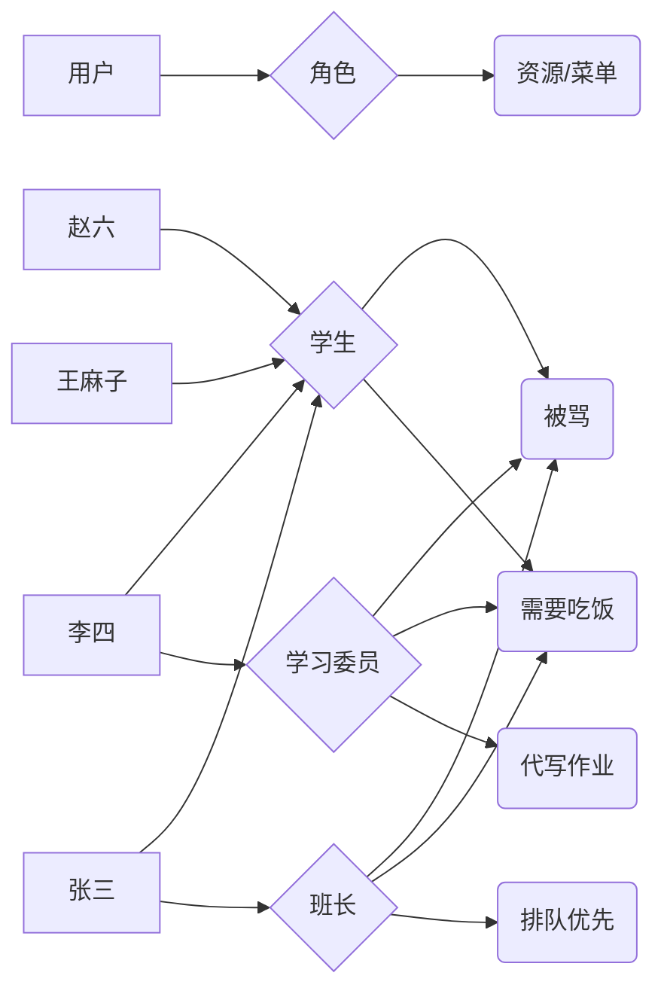

# 权限模块  (建设中)

## 模块组成

| 模块 | 说明 |
| ---- | ---- |
| iam-admin | 管理后台：用户、角色、菜单等管理 |
| iam-admin-starter | 管理后台独立启动器 |
| iam-admin-ui | 管理后台前端界面 |
| iam-common | 公共模块：实体、常量、工具 |
| iam-session | 会话模块：会话管理、JWT Token、认证过滤器、请求控制 |
| iam-portal | 门户登录：统一登录、注册、个人中心、菜单树 |
| iam-portal-starter | 门户登录独立启动器 |
| iam-portal-ui | 门户登录前端界面 |

## RBAC 模型

RBAC（Role-Based Access Control，基于角色的访问控制）：权限与角色相关联，用户通过成为角色的成员而得到这些角色的权限。权限赋予角色，角色赋予用户，中间以角色为纽带，简化权限管理。

### 模型图

### 权限描述

- 张三是班长
- 李四是学习委员
- 所有的人都是学生
- 班长排队优先
- 学习委员需要帮代写作业
- 所有的职位都需要吃饭，也都会被骂

以上描述均以角色为中间关系：给定任何一个人，都能知道他的角色；给定任何一个角色，都能知道他涉及的事，从而确认任何一个人涉及的事。示例中的"排队优先、代写作业"等即受控资源，在新库 IAM 体系中以菜单形式配置。

### 实体与 IAM 表对照

| 模型实体 | IAM 模块 | 说明 |
| -------- | -------- | ---- |
| 用户 | 用户管理 | 权限主体，归属部门与岗位 |
| 角色 | 角色管理 | 权限载体，连接用户与资源 |
| 资源 | 菜单管理 | 受控资源，以菜单形式配置权限 |
| — | 部门管理 | 组织架构，用户的归属维度 |
| — | 岗位管理 | 岗位信息，用户的职务维度 |
