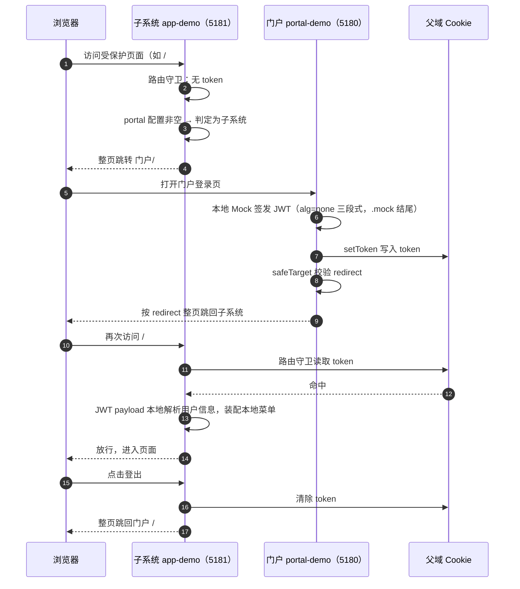

# 示例工程

@sh/ui-core 仓库的 demos 目录提供两个可独立运行的示例工程：portal-demo（5180，模拟企业门户）与 app-demo（5181，子系统接入标准样例）。两者构成「门户 + 子系统」双站生态，内置 Mock 数据，均无需后端即可完整演示登录闭环。

> **portal-demo 不是微前端主应用。** 两个 demo 是同一套单点登录协议下的两种角色示范：应用间通过整页跳转切换，登录态由父域 Cookie 共享，不引入任何微前端运行时。

## 总览

| 工程 | 端口 | 角色 | 说明 |
|---|---|---|---|
| portal-demo | 5180 | 门户 | 登录上游：自持登录页，维护「我的应用」导航与个人中心 |
| app-demo | 5181 | 子系统 | createAdminApp 装配标准样例：完整后台外壳 + 菜单示例 |

- **双站模拟**：本地以双端口模拟两个站点（Cookie 不区分端口，localhost 跨端口互通即模拟父域共享）；真实环境为门户域名与子系统域名。
- **无后端闭环**：登录页本地签发 Mock JWT，用户信息由 JWT payload 本地解析，菜单为本地静态菜单。
- **联调真实后端**：env.js 的 baseApi 替换为真实接口地址（推荐同域反代），app-demo 菜单来源切换为 remote。

## 启动方式

要求 Node 22+ 与 pnpm 11+。克隆仓库后：

```bash
pnpm install       # workspace 安装
pnpm dev           # 并行启动 portal-demo（5180）与 app-demo（5181）
pnpm dev:portal    # 仅启动门户 portal-demo，端口 5180
pnpm dev:app       # 仅启动子系统 app-demo，端口 5181
```

启动后访问：

- 门户：<http://localhost:5180>
- 子系统：<http://localhost:5181>

建议先各自单独打开两个地址，直观感受门户与子系统的页面形态，再按后文「联跑演示」一节走通完整登录闭环。

## portal-demo：门户角色演示

### 定位

演示「门户侧」如何接入 @sh/ui-core。门户是登录上游：自持登录页与注册类页面，维护「我的应用」导航与个人中心；子系统未登录时整页跳入门户登录，登录成功后凭父域 Cookie 免登回跳。

### 技术要点

**1. 不走 createAdminApp 的裸装方式**

createApp + Element Plus 全量引入 + 自建 hash 路由（/login、/ 两条）+ 自写 beforeEach 守卫。门户页面形态与后台外壳差异较大，不消费包内 Layout/主题/store/preset。

```js
// src/portal/main.js（节选）
setRuntimeEnv(runtimeEnv)   // 非 createAdminApp 场景的必要步骤：使用包能力前显式注入运行时环境

const router = createRouter({
  history: createWebHashHistory(),
  routes: [
    { path: '/login', component: Login },   // 门户自持登录页
    { path: '/', component: Portal }        // 门户主页
  ]
})

// 自写守卫：无 token 访问非登录路由 → 携带 redirect 去登录页
router.beforeEach((to, from, next) => {
  if (!getToken() && to.path !== '/login') {
    next('/login?redirect=' + encodeURIComponent(to.fullPath))
  } else {
    next()
  }
})
```

**2. 显式注入运行时环境**

`setRuntimeEnv(runtimeEnv)` 来自 @sh/ui-core，须在所有包能力使用前调用——这是非 createAdminApp 场景的必要步骤。runtimeEnv 由 env.js 聚合导出（appCode、env、portal、title、baseApi）。

**3. 登录页 Mock 签发 JWT**

输入账号与昵称即可登录：本地签发三段式 JWT（header 为 alg=none，结尾以 `.mock` 标识 Mock 签发），调用包内 `setToken`（@sh/ui-core/utils/auth）写入父域 Cookie，按 `?redirect` 参数回跳子系统。

> Mock JWT 仅用于本地演示，不具备安全性；生产环境的 JWT 由真实登录服务签发。

```js
// src/mock/sso.js（核心逻辑）
// 本地签发三段式 JWT：header(alg=none) + payload(userCode/username/nickname) + '.mock' 结尾标识
export function issueJwt(username, nickname) {
  const header = encode('{"alg":"none","typ":"JWT"}')
  const payload = encode(JSON.stringify({ userCode: 'UC-' + username, username, nickname }))
  return header + '.' + payload + '.mock'
}
```

**4. 回跳地址校验**

回跳前用包内 `safeTarget`（@sh/ui-core/utils/safe-target）校验回跳地址，防开放重定向：相对路径放行；绝对地址仅允许 http(s) 且与本站同 host 或同父域，不合法则回落 `/`。

**5. 仅消费包的工具层**

setRuntimeEnv（@sh/ui-core）、getToken / setToken（@sh/ui-core/utils/auth）、safeTarget（@sh/ui-core/utils/safe-target）、redirectToLogin（@sh/ui-core/core/logout，登出复用：清 Cookie + 整页跳 /#/login）。不使用 Layout/主题/store/preset。

**6. 门户页面均为静态演示**

我的应用卡片新标签免登直达子系统（依托 Cookie 跨端口共享登录态），应用列表为本地常量、预留接口化；个人中心的用户编码/账号来自 JWT payload（只读），昵称修改会重新签发 JWT 回写 Cookie，子系统侧下次进入时生效；修改密码为本地校验 Mock，不持久化。

### env.js 配置

```js
const configs = {
  // portal 为空 = 本工程即门户自身（登录路由 /#/login 自持），无后端即可完整闭环
  "local": { "portal": "",                               "title": name + "【LOCAL】", "baseApi": "/api" },
  "uat":   { "portal": "http://portal.uat.example.com",  "title": name + "【UAT】",   "baseApi": "https://api.uat.example.com" },
  "prod":  { "portal": "http://portal.example.com",      "title": name,               "baseApi": "https://api.example.com" }
}
```

### 源文件结构

```text
portal-demo/
├── env.js                      # 唯一配置入口：local 下 portal 为空 = 本工程即门户自身
├── vite.config.js              # 端口 5180（常规 Vite 配置，不使用 createUiCorePreset）
└── src/
    ├── mock/
    │   └── sso.js              # Mock JWT 签发 issueJwt 与 payload 解析 parseJwtPayload
    └── portal/
        ├── main.js             # 裸装入口：setRuntimeEnv + hash 路由（/login、/）+ 自写守卫
        ├── App.vue             # 根组件（router-view）
        ├── Portal.vue          # 门户主页 /#/：顶栏（昵称/登出）+ 我的应用 / 个人中心
        └── views/
            ├── Login.vue       # 自持登录页 /#/login：签发 JWT 写 Cookie，按 redirect 回跳
            ├── Home.vue        # 我的应用卡片：新标签免登直达子系统
            └── Profile.vue     # 个人中心：基本资料（昵称修改）+ 修改密码（Mock）
```

## app-demo：子系统接入标准样例

### 定位

演示子系统如何用 createAdminApp 一行装配出完整后台外壳——布局、路由守卫、菜单、标签页、用户信息等全部由包提供，消费方只写业务路由、业务页面与配置。

### 技术要点

**1. main.js 一行装配**

```js
import { createAdminApp } from '@sh/ui-core'
import { runtimeEnv } from '../env.js'
import { routes, views } from './router'
import { localMenus } from './router/localMenus'

createAdminApp({
  env: runtimeEnv,      // 运行时环境（包内自动完成 setRuntimeEnv 注入）
  routes,               // 业务路由
  views,                // 动态路由组件池
  // 菜单来源：'local' 本地静态菜单（无后端即可完整闭环）| 'remote' 登录后走远端菜单接口
  // demo 用本地菜单便于离线运行；联调真实后端改为 'remote'
  menuSource: 'local',
  localMenus,
  feature: { tagsView: true, settings: false, topNav: false, search: true, fullscreen: true }
})
```

**2. 业务路由与组件池**

业务路由根组件引用包内 `Layout`；views 为 `import.meta.glob` 组件池，必须在消费方求值（动态路由按菜单 component 字符串在此匹配组件）：

```js
// src/router/index.js
import { Layout } from '@sh/ui-core'

export const routes = [
  {
    path: '/',
    component: Layout,
    redirect: '/index',
    children: [{ path: 'index', component: () => import('../views/index.vue'), name: 'Index', meta: { title: '首页', icon: 'dashboard' } }]
  }
]

// 动态路由组件池：import.meta.glob 必须在消费方求值
export const views = import.meta.glob('../views/**/*.vue')
```

**3. localMenus 本地静态菜单**

若依兼容格式，menuSource 为 'local' 时经包内 filterAsyncRouter 转换：一级菜单 component 为特殊值 `'Layout'`；二级菜单 component 为字符串，须与 views 池键 `'views/'` 后的路径一致：

```js
// src/router/localMenus.js
export const localMenus = [
  {
    path: '/demo',
    component: 'Layout',
    meta: { title: '组件演示', icon: 'example' },
    children: [
      {
        path: 'menu-demo',
        component: 'demo/menu-demo',   // 匹配 views 池中的 '../views/demo/menu-demo.vue'
        name: 'MenuDemo',
        meta: { title: '菜单示例', icon: 'list' }
      }
    ]
  }
]
```

**4. feature 外观开关**

feature 按键覆盖包内默认外观，仅支持包内声明的外观键（清单见第二章 [createAdminApp 参数](./ui-core.md#createadminapp-参数)）；demo 配置开启标签页（`tagsView`），传入的未声明键会被静默忽略。

**5. vite.config.js 使用 createUiCorePreset**

按需引入、SVG 图标、自动导入等由预设统一装配：

```js
import { defineConfig } from 'vite'
import { createUiCorePreset } from '@sh/ui-core/vite'

export default defineConfig(({ command }) => ({
  base: '/',
  plugins: [...createUiCorePreset({ isBuild: command === 'build' })],
  server: { port: 5181, host: true }
}))
```

### env.js 配置

```js
const configs = {
  // portal 指向门户地址，本地双端口模拟双站；真实环境为门户域名
  "local": { "portal": "http://localhost:5180",           "title": name + "【LOCAL】", "baseApi": "/api" },
  "uat":   { "portal": "http://portal.uat.example.com",   "title": name + "【UAT】",   "baseApi": "https://api.uat.example.com" },
  "prod":  { "portal": "http://portal.example.com",       "title": name,               "baseApi": "https://api.example.com" }
}
```

### 源文件结构

```text
app-demo/
├── env.js                      # 唯一配置入口：portal 指向门户地址
├── vite.config.js              # createUiCorePreset 预设，端口 5181
└── src/
    ├── main.js                 # createAdminApp 装配入口
    ├── router/
    │   ├── index.js            # 业务路由（根组件 Layout）+ views 组件池
    │   └── localMenus.js       # 本地静态菜单（若依兼容格式）
    └── views/
        ├── index.vue           # 首页：登录状态/用户信息展示、退出登录、前往门户
        └── demo/
            └── menu-demo.vue   # 菜单示例页：由动态路由 + 组件池匹配渲染
```

## 联跑演示：完整登录闭环

两个地址同时打开即可联跑。Mock 模式下，用户信息由 JWT payload 本地解析，菜单为本地静态菜单：



登录后，门户「我的应用」卡片可新标签免登直达子系统（同一父域 Cookie），子系统首页亦提供「前往门户」双向导航。

## 两个 demo 的区别对照表

| 维度 | portal-demo（5180） | app-demo（5181） |
|---|---|---|
| 定位 | 门户角色演示 | 子系统接入标准样例 |
| 装配方式 | 裸装 Vue：createApp + setRuntimeEnv | createAdminApp 一行装配 |
| 登录页 | 自持 /#/login | 无登录页（登录交给门户） |
| whiteList | 自持登录路由免登（自写守卫内排除 /login，等价白名单） | 空（createAdminApp 默认值） |
| 菜单来源 | 无菜单概念，门户页静态 | local 本地菜单（可切 remote） |
| 消费的包能力 | 仅工具层：setRuntimeEnv / getToken / setToken / safeTarget / redirectToLogin | 全套外壳能力：createAdminApp / Layout / store / preset 等 |
| 何时参考 | 自建门户或登录上游时 | 接入业务子系统时 |

## 边界说明

- 两个 demo 刻意精简，均不含 CRUD 业务模板页（表格、表单、上传等业务能力见第二章「内置全局能力清单」）。
- demo 的 env.js 配置结构即生产结构（configs 按 local/uat/prod 分环境，每环境 portal/title/baseApi 三项），接入时仅需按环境替换 portal/title/baseApi 的值。
- 调试辅助：localStorage 写入 `mock-portal` / `mock-api` 可临时覆盖门户地址与 API 基址，无需改代码。
