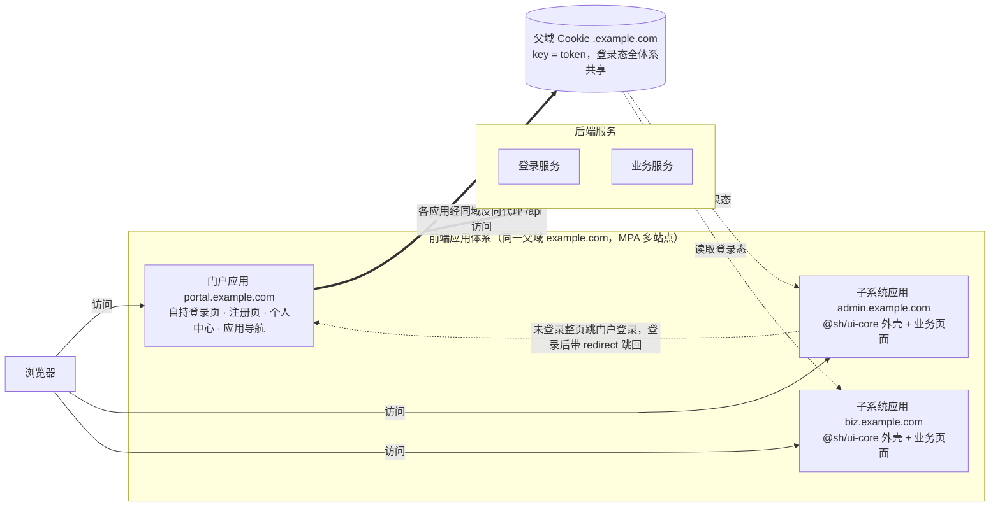

# 前端框架简介

## 为什么需要前端框架

现代中后台开发通常不止一个应用：一个统一登录门户，加若干个业务管理后台。直接用 Vue + Vite 从零搭建每一个应用虽然灵活，但布局、菜单、权限、请求封装、登录逻辑都要各写一遍，工作量大、周期长，且各应用外观与交互难以统一。

本前端框架的核心目标，是把「管理后台通用外壳」沉淀为可复用的基础设施，解决以下问题：

- **重复建设**：布局、菜单、权限、请求、登录等基础能力一次建设、所有应用复用，新应用只写业务页面
- **风格不一**：所有应用共享同一套外壳与设计规范，用户跨应用获得一致的外观与操作习惯
- **登录割裂**：统一登录体系，一次登录全体系互通，支持免登跳转与统一登出
- **规范失控**：统一技术栈、依赖版本与工程配置，多应用并行维护成本可控
- **交付耦合**：各应用独立仓库、独立构建、独立部署，互不阻塞

## 整体架构

用一句话概括形态：**一个门户应用 + 多个子系统应用**的多站点（MPA）体系。

- **门户应用**：登录上游，自带登录页、注册页、个人中心与应用导航，登录态从这里签发
- **子系统应用**：业务应用，每个都是独立仓库、独立构建、独立部署的完整前端工程，只写业务页面与接口
- **共享外壳**：所有子系统依赖 `@sh/ui-core` 包，获得完全一致的布局、菜单、权限、请求等能力
- **登录态共享**：所有应用部署在同一父域的不同子域名下（如 `portal.example.com`、`admin.example.com`），登录态写入父域 Cookie，父域下所有应用共享，一次登录处处生效
- **登录协作**：子系统不含登录页；未登录访问子系统时，整页跳转到门户登录页，登录成功后携带回跳地址跳回原页面

需要特别强调：**这不是微前端**。体系中没有 qiankun、wujie、模块联邦，应用之间不嵌套、不共享运行时，而是通过浏览器整页跳转协作。每个应用都是独立完整的站点，因此不存在主子应用技术栈绑定问题——只要各应用保持一致的版本组合，即可获得一致外观与跨站缓存复用收益。

门户与各子系统的请求均通过各自域名下的 `/api` 同域反向代理到达后端服务（登录服务、业务服务），天然无跨域问题。

## 技术栈一览

| 技术 | 版本 | 说明 |
|---|---|---|
| Vue | 3.5 | 组合式 API（Composition API） |
| Element Plus | 2.10 | 中后台 UI 组件库 |
| Pinia | 3 | 状态管理 |
| Vue Router | 4 | 路由，统一采用 hash 模式 |
| Vite | 6 | 构建工具 |
| pnpm | monorepo | 包管理，workspace 组织多包工程 |
| Node | 22+ | 开发与构建环境 |

路由采用 hash 模式（URL 中带 `#`）：静态部署只需一条「找不到文件就回退 index.html」的服务器规则，无需服务端路由配置；同时登录回跳地址形如 `/#/login?redirect=...`，跨站点跳转时地址形态稳定。

## 生态组成

| 组成 | 说明 |
|---|---|
| `@sh/ui-core` 核心包 | 管理后台统一外壳：布局、菜单、权限、请求、字典、公共组件。npm 包名 `@sh/ui-core`，当前版本 0.0.14，子系统安装后即获得全套外壳能力 |
| 示例工程 | 两个可独立运行的 demo：门户 demo 与子系统 demo，各自启动 dev server；门户登录依赖真实后端登录服务（本地经 vite 代理 `/api` 转发），子系统本地菜单不依赖后端菜单接口，配合后端登录服务即可本地走通「跳登录 → 回跳」闭环，见第三章 |
| 真实落地参考 | 「门户应用 + 管理后台应用」的双应用生产实践，见第四章 |

## 核心概念速览

| 概念 | 一句话解释 |
|---|---|
| 门户应用 | 登录上游：自持登录页与注册页，登录态从这里签发，用户登录后跳回子系统 |
| 子系统应用 | 业务应用：不含登录页，未登录访问时整页跳转到门户 |
| appCode | 应用标识：部署域名第一段即 appCode（如 `admin.example.com` → `admin`），经请求头 `app-code` 携带，服务端按它过滤该应用可见的菜单 |
| 父域 Cookie | 登录态载体：key 为 `token`，作用域为父域 `.example.com`，同父域下所有应用共享 |
| env.js | 每个应用唯一的运行时配置入口（门户地址、接口基址等），按访问域名自动判定环境，不使用 .env 文件 |
| 远端菜单 | 菜单树由服务端按 appCode 下发，前端按菜单中的组件路径从页面组件池匹配渲染 |
| 白名单路由 | 免登录即可访问的路由，如门户的登录页、注册页 |

## 能力矩阵

以下能力均由 `@sh/ui-core` 提供，子系统零成本获得：

| 能力 | 说明 |
|---|---|
| 布局外壳 | 侧边栏、导航栏、多页签、面包屑、全屏、搜索 |
| 动态菜单 | 远端（服务端下发）与本地（静态配置）两种来源 |
| 权限控制 | 路由级权限 + 按钮级权限指令 |
| 字典 | `useDict` 取值 + `DictTag` 渲染，带本地缓存 |
| 请求封装 | 自动携带 `token` 与 `app-code` 请求头、防重复提交、统一错误码处理 |
| 全局组件 | 分页、字典标签、文件 / 图片上传、富文本、表格设置等，全局注册免 import |
| 插件与指令 | `$modal` / `$tab` / `$auth` 插件；`v-hasPermi` / `v-hasRole` / `v-copyText` 指令 |
| 主题 | 主色派生 + 暗色模式 |

## 适用场景与边界

**适合：**
- 中后台多应用体系：多个管理后台需要统一登录、统一外观、统一权限
- 统一技术栈团队：全员 Vue 3，追求一致的工程规范与维护成本
- 需要统一登录与权限：一次登录全体系互通，菜单与权限由服务端集中管控

**不适合：**
- 需要多技术栈共存或严格隔离的微前端场景：本框架采用 MPA + 整页跳转协作，不是微前端
- 面向 C 端的定制化前台：本框架面向中后台，外观与交互均为管理后台范式

## 版本与兼容策略

全体系所有应用锁定同一版本组合：`@sh/ui-core`、`vue`、`element-plus` 在各应用中的版本保持一致。

- 升级外壳只需修改各应用 package.json 中的版本号，import 路径保持不变（包产物路径镜像源码结构，对外出口稳定）
- 版本一致保证公共依赖的打包产物在各应用间 URL 与内容一致，浏览器缓存跨站点复用，整页跳转到另一个应用时公共资源秒开

## 阅读路径

1. **第二章 ui-core 核心包**：理解外壳能力与接入方法
2. **第三章 示例工程**：本地跑通门户与子系统 demo
3. **第四章 接入实践**：门户 + 管理后台双应用的真实落地
4. **第五章 拆解指南**：从存量单体前端拆出业务子系统的标准动线
