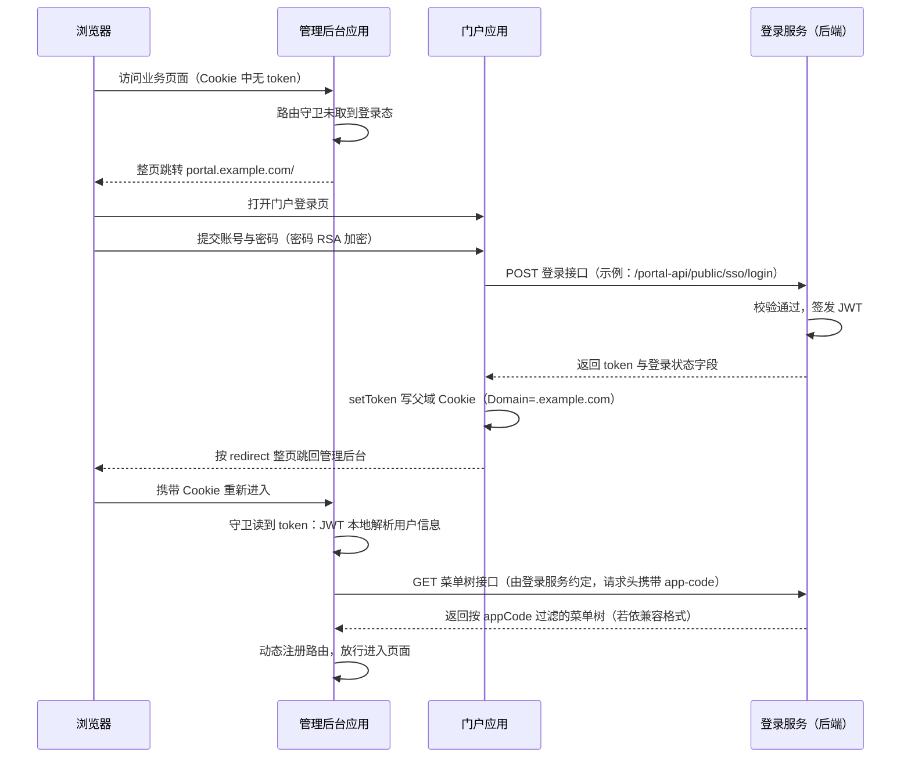

# 接入实践

本章整理一套真实落地的「门户应用 + 管理后台应用」双应用接入实践，覆盖从工程结构、本地开发到生产部署的完整接入步骤。两个应用均基于 `@sh/ui-core`（本章基线版本 0.0.14）：布局、路由守卫、请求封装、登录态管理、菜单装配等共享能力全部由包承担，业务工程只保留「环境配置 + 装配入口 + 接口层 + 页面组件」四类文件。

阅读前提：有 Vue 3 / Vite 基础。全文统一使用示例标识——示例 appCode：`admin`（管理后台应用）与 `portal`（门户应用）；示例域名：`*.example.com`；示例接口前缀：`/admin-api`、`/portal-api`（**示例前缀，以实际服务为准**）。

## 🧭 一、场景设定

某企业中后台体系包含两类前端应用：门户应用是**登录上游**，自持登录/注册页、个人中心、修改密码、登录日志等用户自助功能；管理后台应用是**纯业务子系统**，没有登录页，菜单由服务端按 appCode 下发。两类应用的职责边界如下：

| | 门户应用 | 管理后台应用 |
|---|---|---|
| 定位 | 登录上游，用户自助 | 纯业务子系统 |
| 登录 / 注册页 | 自持（`/login`、`/register`） | 无，登录委托门户 |
| 免登录白名单 | `['/login', '/register']` | `[]` |
| `env.portal` | 恒为空串（自身即登录上游） | 门户完整地址（或按域名推导） |
| appCode | `portal` | `admin` |
| 菜单来源 | 远端（`menuSource: 'remote'`） | 远端（`menuSource: 'remote'`） |
| 典型页面 | 登录、注册、个人中心、修改密码、登录日志 | 各业务域管理页面 |

业务工程的完整文件面（以管理后台应用为例；门户应用结构相同，仅多出自持页面）：

```text
admin-app/
├── env.js                  # 运行时环境：appCode / portal / title / baseApi
├── index.html
├── vite.config.js
├── package.json
└── src/
    ├── main.js             # createAdminApp 装配入口（唯一装配点）
    ├── router/index.js     # 公共静态路由 + views 组件池
    ├── api/                # 接口层：按业务域拆文件
    │   ├── system/user.js
    │   ├── system/role.js
    │   └── log/loginlog.js
    └── views/              # 页面组件池：目录路径对应远端菜单 component 字段
        ├── dashboard/index.vue
        └── system/user/index.vue
```

## 🏢 二、管理后台应用接入

### 2.1 装配入口 main.js

管理后台没有登录入口（登录委托门户），因此白名单为空；菜单走远端。整个应用的装配只有一次 `createAdminApp` 调用：

```js
// src/main.js
import { createAdminApp } from '@sh/ui-core'
import { runtimeEnv } from '../env.js'
import { constantRoutes, views } from './router'

createAdminApp({
  env: runtimeEnv,          // 运行时环境（env.js 聚合对象，包内全局注入）
  routes: constantRoutes,   // 公共静态路由
  views,                    // views 组件池（import.meta.glob 结果）
  // 管理后台无登录入口（登录委托门户），无免登录页，白名单为空
  whiteList: [],
  // 菜单来自服务端，按 appCode 下发
  menuSource: 'remote'
})
```

`createAdminApp` 一次调用完成全部装配：Element Plus 全局配置、全局属性（字典、下载、时间格式化等）、全局组件、Pinia、路由与守卫均由包内完成，业务工程不再重复装配。守卫行为由两个配置决定：无 token 访问时，先匹配 `whiteList`（精确路径），命中放行；未命中则整页跳往 `env.portal` 指向的门户登录页（`portal` 为空串时才走应用内 `/login` 导航，子系统不适用）。

### 2.2 运行时环境 env.js

env.js 是整个应用的「环境名片」，四个字段各司其职：`appCode`（服务端按它隔离菜单与应用注册）、`portal`（无 token 时整页跳转的目标门户地址）、`title`（页面标题与环境标识）、`baseApi`（接口基址）。本地开发显式配置，云端环境靠域名推导：

```js
// env.js：运行时环境配置（放工程根目录，main.js 以 '../env.js' 引入）
const name = '管理后台'

// 应用编码，与服务端应用注册一致。
// 域名访问时请求头 app-code 取域名首段（admin.example.com → admin），
// localhost / IP 访问时取此值
export const appCode = 'admin'

const configs = {
  // 本地联调：portal 指向门户 dev 地址（示例端口，按本机实际调整）；baseApi='/api' 走 vite 代理
  'local': {portal: 'http://localhost:5180', title: name + '【LOCAL】', baseApi: '/api'},
  // uat/prod：portal 与 baseApi 留空，按域名推导
  // （admin.uat.example.com → portal.uat.example.com / api.uat.example.com）
  'uat':   {portal: '', title: name + '【UAT】', baseApi: ''},
  'prod':  {portal: '', title: name,           baseApi: ''}
}

// 按 hostname 粗判环境：localhost/127.0.0.1 → local，
// 含 .dev. / .sit. / .uat. → 对应环境，其余 → prod
function getEnv() {
  const host = window.location.host
  if (host.indexOf('localhost') > -1 || host.indexOf('127.0.0.1') > -1) { return 'local' }
  if (host.indexOf('.dev.') > -1) { return 'dev' }
  if (host.indexOf('.sit.') > -1) { return 'sit' }
  if (host.indexOf('.uat.') > -1) { return 'uat' }
  return 'prod'
}

// 域名推导：把当前域名首段替换为 target。
// 非域名访问（localhost、纯 IP）返回 ''，不推导——本地必须显式配置
function deriveDomainUrl(target) {
  const hostname = window.location.hostname
  if (hostname.indexOf('.') < 0) { return '' }
  if (/^\d{1,3}(\.\d{1,3}){3}$/.test(hostname)) { return '' }
  return window.location.protocol + '//' + target + '.' + hostname.split('.').slice(1).join('.')
}

// 取值优先级：localStorage mock（mock-portal / mock-api，联调用）> 显式配置 > 域名推导
function getConfig(envKey) {
  const c = {...(configs[envKey] || configs['local'])}
  c.portal = localStorage.getItem('mock-portal') || c.portal
  c.baseApi = localStorage.getItem('mock-api') || c.baseApi
  if (!c.portal) { c.portal = deriveDomainUrl('portal') }
  if (!c.baseApi) { c.baseApi = deriveDomainUrl('api') }
  return c
}

export const env = getEnv()
const config = getConfig(env)

// 运行时环境聚合：经 createAdminApp({ env }) 注入包内，全包共享
export const runtimeEnv = {appCode, env, ...config}
```

要点：

- `baseApi` 两种模式二选一，且全环境保持一致：相对路径 `/api`（同域反代，dev 走 vite 代理），或留空由域名推导出独立 API 域名。
- 子系统的 `portal` 必须能解析出门户完整地址（local 显式配置，uat/prod 靠域名推导）；缺失或配错时，无 token 访问会跳向坏地址，表现为白屏或 404。
- env.js 存在两种等价写法：**显式配置**（local/uat/prod 三环境全量写死域名，见 [ui-core.md](./ui-core) 与 app-demo）与**域名推导**（uat/prod 留空由 `deriveDomainUrl` 按当前域名推导，即本节写法）。同一工程全环境只用一种，不要混用；localhost / 纯 IP 访问无域名可推，两种写法下 local 环境都必须显式配置。

### 2.3 构建配置 vite.config.js

插件装配交由 `@sh/ui-core` 的 preset，业务工程不手工罗列 Vue / 自动导入 / 图标等插件；本地联调通过 dev 代理把 `/api` 转发到后端并去掉前缀：

```js
// vite.config.js
import path from 'path'
import { defineConfig } from 'vite'
import { createUiCorePreset } from '@sh/ui-core/vite'

export default defineConfig(({command}) => {
  return {
    base: '/',
    // Vue、自动导入、svg-sprite 等插件由 preset 统一装配
    plugins: [...createUiCorePreset({isBuild: command === 'build'})],
    resolve: {
      alias: {
        '~': path.resolve(__dirname, './'),
        '@': path.resolve(__dirname, './src')
      },
      extensions: ['.mjs', '.js', '.ts', '.jsx', '.tsx', '.json', '.vue']
    },
    build: {
      outDir: 'dist',
      rollupOptions: {
        output: {
          chunkFileNames: 'static/js/[name]-[hash].js',
          entryFileNames: 'static/js/[name]-[hash].js',
          assetFileNames: 'static/[ext]/[name]-[hash].[ext]'
        }
      }
    },
    server: {
      port: 5170,   // 示例端口，与门户 dev 端口错开即可
      host: true,
      proxy: {
        // baseApi='/api' 时本地联调走此代理；rewrite 去掉 /api 前缀转发后端
        '/api': {
          target: 'http://localhost:8080',
          changeOrigin: true,
          rewrite: (p) => p.replace(/^\/api/, '')
        }
      }
    }
  }
})
```

### 2.4 接口层 api 目录组织

接口层按业务域拆文件（`system/user.js`、`system/role.js`、`log/loginlog.js`），全部统一从包内引入 `request` 实例。`request` 已内置：接口基址注入（`runtimeEnv.baseApi`）、`token` 与 `app-code` 请求头、GET 参数序列化、POST/PUT 防重复提交、统一错误码提示、401 会话过期处理、blob 下载——业务 api 文件只关心 `url` / `method` / `params` / `data`：

```text
src/api/
├── system/
│   ├── user.js
│   └── role.js
└── log/
    └── loginlog.js
```

```js
// src/api/system/user.js
import request from '@sh/ui-core/utils/request'

// 分页查询（GET：params 自动序列化到 url）
export const userPage = (params) => {
  return request({url: '/admin-api/user/page', method: 'get', params})
}

// 新增（POST：json body）
export const userCreate = (data) => {
  return request({url: '/admin-api/user/create', method: 'post', data})
}
```

> `/admin-api` 为示例前缀，以实际服务为准。

### 2.5 远端菜单驱动页面

管理后台的页面由「组件 + 服务端菜单配置」共同构成，前端不写菜单也不写业务路由。新增一个页面只有两步：

1. `src/views` 下放 `.vue` 组件（如 `src/views/system/dict/index.vue`）；
2. 服务端菜单管理里按 appCode 配置菜单项，把菜单的 `component` 字段配到该组件路径（`system/dict/index`，不带 `.vue`）。

登录后包内 permission store 调用菜单树接口（由登录服务约定：GET 请求，响应 `res.data` 为若依兼容菜单树数组；`component` 取值 `Layout`（根布局）/ `ParentView`（多级父容器）/ `InnerLink`（内链 iframe）或组件路径字符串），再动态注册路由。组件路径字符串按 `views/<component>` 规则从组件池匹配：`system/user/index` ↔ `src/views/system/user/index.vue`。若依路由字段（`hidden`、`meta` 等）语义不变。

组件池与公共路由定义在 `src/router/index.js`：

```js
// src/router/index.js
import { Layout } from '@sh/ui-core'

// 公共静态路由：业务工程只注册首页落地；
// /redirect、404 兜底、/401 均由 @sh/ui-core 内置，无需重复注册
// 管理后台不注册 /login（无登录入口）
export const constantRoutes = [
  {
    // 首页落地：登录回跳 /#/ 命中后进入 /index（静态兜底，不依赖菜单数据修正）
    path: '/',
    component: Layout,
    redirect: '/index',
    hidden: true,
    children: [
      {
        path: 'index',
        component: () => import('@/views/dashboard/index.vue'),
        name: 'AdminHome',   // 避免与远端菜单路由同名（addRoute 同名会覆盖）
        meta: {title: '首页', icon: 'dashboard'}
      }
    ]
  }
]

// views 组件池：必须在业务工程内求值（包内求值看不到业务工程的 views 目录）
export const views = import.meta.glob('../views/**/*.vue')
```

菜单本身是服务端数据：调整菜单标题、图标、排序、隐藏只改菜单配置，无需前端发版；新增/删除页面组件才需要前端发版。

## 🚪 三、门户应用接入

### 3.1 装配入口与差异点

门户应用的装配方式与管理后台相同，差异集中在三处——白名单、`env.portal` 与自持页面：

```js
// src/main.js（门户）
import { createAdminApp } from '@sh/ui-core'
import { runtimeEnv } from '../env.js'
import { constantRoutes, views } from './router'

createAdminApp({
  env: runtimeEnv,
  routes: constantRoutes,
  views,
  // 门户自持免登录页必须加入白名单，
  // 缺失会与守卫的登录跳转形成死循环
  whiteList: ['/login', '/register'],
  menuSource: 'remote'
})
```

```js
// env.js（门户）差异点
export const appCode = 'portal'

// 门户自身即登录上游：portal 恒为空串。
// 守卫据此区分行为：portal 为空 → 无 token 时应用内导航 /login?redirect=...；
// portal 有值 → 无 token 时整页跳向该地址（子系统走这条）
export const portal = ''

export const runtimeEnv = {appCode, env, portal, ...config}
```

| 差异点 | 管理后台 | 门户 |
|---|---|---|
| `whiteList` | `[]` | `['/login', '/register']` |
| `env.portal` | 门户完整地址 | `''`（空串，自身即登录上游） |
| 静态路由 | 无 `/login` | 注册自持 `/login`、`/register`、`/user/profile/:activeTab?` |
| api 目录 | 业务域接口 | `sso.js`（登录/验证码/注册）+ `user.js`（用户自助） |

门户 `env.js` 的其余字段（`title` / `baseApi` / 环境判断 / 域名推导）与管理后台同构；`baseApi` 本地可直接配网关地址或走 vite 代理。

### 3.2 登录页实现要点

登录页是门户最核心的自持页面，模板为标准 `el-form`（账号 / 密码 / 验证码行 / 登录按钮）。关键实践有七条：

1. **已持 token 直接回跳**：进入登录页先读 token，有 token 立即按 `redirect` 回跳，避免重复登录。
2. **回跳目标必须过 `safeTarget`**：`/` 开头的站内相对路径原样保留走路由；绝对地址仅允许当前域名或同父域，其余一律回退 `/`，防开放跳转。
3. **密码 RSA 加密**：`encrypt` 来自 `@sh/ui-core/utils/jsencrypt`，公钥内置于包内，前端只加密不持有私钥。
4. **登录成功写父域 Cookie**：`setToken(res.data.token)` 由包内完成，Cookie Domain 为共同父域、`SameSite=Lax`。
5. **回跳分两种**：目标为 `http(s)` 绝对地址 → `window.location.href` 整页跳（跨子系统）；`/` 开头 → `router.replace` 站内跳（门户自己的页面）。
6. **验证码按需拉取**：默认不展示；服务端返回的登录状态字段非 0（失败）时才拉验证码接口并展示，接口异常不展示。
7. **登录接口地址由登录服务约定**：示例占位 `/portal-api/public/sso/login`（示例前缀，以实际服务为准）。

```vue
<!-- src/views/login.vue（精简骨架，样式自定） -->
<script setup>
import { getToken, setToken } from '@sh/ui-core/utils/auth'
import { encrypt } from '@sh/ui-core/utils/jsencrypt'
import { safeTarget } from '@sh/ui-core/utils/safe-target'
import { runtimeEnv } from '../../env.js'
import { ssoLogin, captchaImage } from '@/api/sso'

// redirect 取自路由 query（子系统带 redirect 跳来时的落点）
const route = useRoute()
const router = useRouter()
const redirect = route.query.redirect

// 站内相对目标走路由跳，跨站/绝对目标整页跳
function leaveTo(target) {
  if (/^https?:\/\//i.test(target)) {
    window.location.href = target
  } else {
    router.replace(target || '/')
  }
}

// 已持有登录态：直接按 redirect 回跳，不重复登录
if (getToken()) {
  leaveTo(safeTarget(redirect))
}

const loginRef = ref()
const loading = ref(false)
const codeUrl = ref('')
const loginForm = ref({username: '', password: '', captchaCode: '', captchaId: ''})
const loginRules = {
  username: [{required: true, message: '请输入账号', trigger: 'blur'}],
  password: [{required: true, message: '请输入密码', trigger: 'blur'}]
}

function handleLogin() {
  loginRef.value.validate(valid => {
    if (!valid) { return }
    loading.value = true
    ssoLogin({
      username: loginForm.value.username.trim(),
      password: encrypt(loginForm.value.password),   // RSA 加密后再传输
      captchaCode: loginForm.value.captchaCode,
      captchaId: loginForm.value.captchaId
    }).then(res => {
      if (res.data?.token) {
        setToken(res.data.token)                     // 写父域 Cookie
      }
      if (res.data?.loginStatus !== 0) {
        getCode()                                    // 失败：拉验证码，下轮登录携带
        return
      }
      // 成功：按 redirect 回跳（无 redirect 时回门户首页）
      setTimeout(() => { leaveTo(safeTarget(redirect)) }, 600)
    }).finally(() => {
      loading.value = false
    })
  })
}

function getCode() {
  captchaImage().then(res => {
    codeUrl.value = res.data.base64Image
    loginForm.value.captchaId = res.data.captchaId
  })
}
</script>

<template>
  <el-form ref="loginRef" :model="loginForm" :rules="loginRules">
    <!-- 账号 / 密码两个 el-form-item 此处省略 -->
    <!-- 验证码行按需渲染：captchaId 存在（即上轮登录失败拉过验证码）才展示 -->
    <el-form-item prop="captchaCode" v-if="loginForm.captchaId">
      <el-input v-model="loginForm.captchaCode" placeholder="验证码" />
      
    </el-form-item>
    <el-button :loading="loading" type="primary" @click="handleLogin">登录</el-button>
  </el-form>
</template>
```

说明：

- 登录接口响应契约（字段名以实际登录服务约定为准）：`token`（JWT）、`loginStatus`（0 = 成功）、`loginMessage`（失败提示文案，可展示在表单下方）。
- `ref` / `useRoute` / `useRouter` 等 API 由 preset 的自动导入插件提供，无需手写 import；Element Plus 图标等第三方导入需显式引入。

门户 `src/api/sso.js` 示例（登录相关 url 均为泛化占位）：

```js
// src/api/sso.js（示例前缀，以实际服务为准）
import request from '@sh/ui-core/utils/request'

export const ssoLogin = (data) => {
  return request({url: '/portal-api/public/sso/login', method: 'post', data})
}

export const captchaImage = () => {
  return request({url: '/portal-api/public/captcha/image', method: 'get'})
}

export const ssoRegister = (data) => {
  return request({url: '/portal-api/public/sso/register', method: 'post', data})
}

// 登出与菜单树接口由 @sh/ui-core 包内置（user store 与 permission store 消费，
// 路径由登录服务约定），业务侧无需重复定义
```

### 3.3 用户自助页面组织

修改密码、个人中心、登录日志等用户自助页面全部归属门户（登录上游职责），子系统不建对应页面。组织方式：`views/user/` 下按页面拆分，配套接口放 `src/api/user.js`：

```text
src/views/user/
├── change-password.vue          # 修改密码（独立页）
├── profile/
│   ├── index.vue                # 个人中心：tab 容器（路由 /user/profile/:activeTab?）
│   ├── userInfo.vue             # 基本资料
│   ├── userAvatar.vue           # 头像
│   └── resetPwd.vue             # 修改密码 tab
├── login-records/index.vue      # 登录日志
└── operate-logs/index.vue       # 操作日志
```

- 个人中心以静态路由 `/user/profile/:activeTab?` 注册，需登录后访问，**不进白名单**。
- 日志类列表页直接复用包内通用组件（分页、字典标签等），页面只关注列定义与查询条件。

## 🔁 四、双应用协作

### 4.1 登录回跳全链路

两个应用是两个独立部署的 SPA（hash 路由），登录态靠父域 Cookie 共享。完整时序如下：



关键点：

- **用户信息零请求**：token 为三段式 JWT，包内 user store 的 `getInfo` 取中段 base64 解码得到 `userCode` / `username` / `nickname` / `avatar`，不发任何后端请求；头像缺省使用包内默认图。
- **菜单按 appCode 隔离**：包内 request 自动携带 `app-code` 请求头（域名访问时取域名首段，本地取 env.js 的 `appCode`），菜单树接口据此过滤；动态路由注册完成后以 replace 方式重放当前导航，地址栏无变化。
- **redirect 全程透传**：子系统 → 门户的整页跳转带上当前完整地址，登录成功后原样跳回，用户无感。

### 4.2 登出链路

任意应用内触发 `userStore.logOut()`（导航栏用户下拉），链路统一收口：

1. 调登出接口（由登录服务约定：GET 请求，仅需 `token` 请求头，包内已内置调用）；
2. `removeToken` 清父域 Cookie；
3. 整页跳 `{portal}/#/login?redirect=当前完整地址`（`portal` 取 `runtimeEnv.portal`），登录后回到登出前的页面。

登出接口无论成功、失败还是网络异常，都会在 finally 中清 Cookie 并跳转门户，保证本地登录态一定被清掉。

### 4.3 401 会话失效

会话过期由包内响应拦截器统一处理，业务代码无感：

- 任一请求响应 HTTP 401：弹出全局确认框（「登录状态已过期，您可以继续留在该页面，或者重新登录」），防重入标志保证并发多个 401 只弹一次；
- 用户点「重新登录」→ 走与守卫无 token 相同的出口：清 Cookie + 整页跳门户登录，登录后按 redirect 回到原页面；
- 用户点「取消」→ 留在当前页。

## 🚀 五、部署实践

### 5.1 域名规划

| 应用 / 服务 | 域名 | 说明 |
|---|---|---|
| 门户应用 | portal.example.com | 登录上游，父域 Cookie 写入方 |
| 管理后台应用 | admin.example.com | 纯业务子系统 |
| 后端网关 / 反代 | api.example.com | 承接 `/admin-api`、`/portal-api` 实际后端 |

三个域名共享父域 `example.com`，登录态 Cookie 的 Domain 即为 `.example.com`——任意子域名下的应用共享登录，登录一次全网免登。域名首段即 appCode：前端应用域名的首段（`portal` / `admin`）就是请求头 `app-code` 的取值。新增子系统时按同一规则起域名（首段 = 服务端注册的 appCode），无需改 env.js 的 `appCode`。

多环境整组域名同构：uat 环境为 `admin.uat.example.com` / `portal.uat.example.com` / `api.uat.example.com`，env.js 按 `.uat.` 判定环境，域名推导自动落到同环境。

### 5.2 nginx 配置

两个前端站点各一个 server 块，配置同构。SPA 兜底 + 可选同域反代：

```nginx
server {
    listen       80;
    server_name  admin.example.com;   # 门户站点同构，替换域名即可

    # SPA：静态资源 + 路由兜底
    location / {
        root   /usr/share/nginx/html;
        index  index.html;
        try_files $uri $uri/ /index.html;
    }

    # 可选：同域反代后端（baseApi='/api' 模式），同源请求零 CORS。
    # proxy_pass 末尾的 / 会去掉 /api 前缀，与本地 vite rewrite 行为一致
    location /api/ {
        proxy_pass http://backend-gateway:8080/;
        proxy_set_header Host $host;
        proxy_set_header X-Real-IP $remote_addr;
        proxy_set_header X-Forwarded-For $proxy_add_x_forwarded_for;
    }
}
```

hash 路由（`/#/xxx`）本身不产生服务端路径请求，`try_files` 兜底是零成本的标准配置，防止异常路径直出 404。`baseApi` 若采用独立 API 域名模式，则此 `/api` location 不需要，由网关侧统一处理。

### 5.3 K8s 部署

admin 与 portal 各自一组 Deployment + Service，Ingress 按 host 路由到各自 Service：

```yaml
# admin 前端：Deployment + Service（portal 同构，替换名称与镜像）
apiVersion: apps/v1
kind: Deployment
metadata:
  name: admin-ui
  labels: {app: admin-ui}
spec:
  replicas: 1
  selector: {matchLabels: {app: admin-ui}}
  template:
    metadata: {labels: {app: admin-ui}}
    spec:
      containers:
        - name: admin-ui
          image: registry.example.com/admin-ui:TAG   # 由流水线替换
          ports: [{containerPort: 80}]
---
apiVersion: v1
kind: Service
metadata:
  name: admin-ui-svc
spec:
  type: ClusterIP
  selector: {app: admin-ui}
  ports: [{port: 80, targetPort: 80}]
---
# 两个前端的 Ingress：host 路由 + TLS（证书自动签发，简化示例）
apiVersion: networking.k8s.io/v1
kind: Ingress
metadata:
  name: ui-ingress
  annotations:
    cert-manager.io/cluster-issuer: letsencrypt-prod
spec:
  ingressClassName: nginx
  tls:
    - hosts: [admin.example.com, portal.example.com]
      secretName: example-com-tls
  rules:
    - host: admin.example.com
      http:
        paths:
          - path: /
            pathType: Prefix
            backend: {service: {name: admin-ui-svc, port: {number: 80}}}
    - host: portal.example.com
      http:
        paths:
          - path: /
            pathType: Prefix
            backend: {service: {name: portal-ui-svc, port: {number: 80}}}
```

镜像即「纯静态文件 + nginx」：以 `nginx:alpine` 为基底，拷入 dist 产物与 nginx.conf 即可：

```dockerfile
FROM nginx:alpine
COPY ./dist /usr/share/nginx/html
COPY ./nginx.conf /etc/nginx/nginx.conf
CMD ["nginx", "-g", "daemon off;"]
```

### 5.4 构建产物

`pnpm build` 产出 `dist/` 目录：`index.html` + `static/js|css|img|fonts/...`，纯静态文件，任意静态服务器可部署。产物按 `static/[ext]/[name]-[hash]` 规则命名，内容变更即文件名变更，可放心对静态资源开长缓存（`index.html` 不缓存）。

## ✅ 六、接入自查清单

接入完成后逐项核对：

| # | 检查项 | 合格标准 |
|---|---|---|
| 1 | 版本三处一致 | `@sh/ui-core`、`vue`、`element-plus` 版本对齐（本实践基线 0.0.14），以包的 peerDependency 要求为准 |
| 2 | env.js 四字段 | `appCode` / `portal` / `title` / `baseApi` 已按环境配置，local 环境显式可跑 |
| 3 | portal 配置方向 | 子系统配门户**完整地址**（显式或域名推导）；门户自身配**空串** |
| 4 | 免登录白名单 | 自持免登录页（`/login`、`/register` 等）已全部加入 `whiteList` |
| 5 | views 组件池 | `import.meta.glob` 在业务工程 `router/index.js` 内求值，并经 `createAdminApp({ views })` 传入 |
| 6 | 菜单与组件路径一致 | 服务端菜单 `component` 字段 = `src/views` 下相对路径（不带 `.vue`），且按 appCode 隔离 |
| 7 | Cookie 域名 | 各应用域名共享共同父域（Cookie `Domain=.example.com`）；localhost 本地无域限制，跨端口天然互通 |
| 8 | `/api` 代理 / 反代 | 本地 vite proxy 或生产 nginx 反代已配置，rewrite 去前缀行为一致，模式全环境统一 |
| 9 | 登出回跳 | 登出后整页跳门户登录，`redirect` 携带当前完整地址，重新登录可回到原页面 |

## ❓ 七、常见问题

### Q1: 登录后子系统中用户信息从哪来？

JWT 本地解析。token 为三段式 JWT，包内 `getInfo` 取中段 base64 解码即得 `userCode` / `username` / `nickname` / `avatar`，全程无需后端接口，也不存在「获取用户信息接口挂了导致页面不可用」的问题。

### Q2: 为什么未登录会整页跳走，而不是弹窗登录？

两个应用是独立部署的两个 SPA，共享的只有父域 Cookie。弹窗只能在同一个应用内切换视图，跨应用拿不到登录页；整页跳门户是唯一可靠的登录态共享方式，且跳转携带 `redirect`，登录后能精确回到原页面。

### Q3: 本地 localhost 多端口为什么能共享登录态？

Cookie 域解析对 `localhost` / `127.0.0.1` 做了特殊处理：不设置 domain（host-only Cookie），浏览器对同一 host 的任意端口共享 Cookie，因此 `localhost:5170` 与 `localhost:5180` 天然互通。同时域名推导函数对非域名访问返回空串，portal 与 baseApi 必须显式配置——这是本地与云端的配置分界线。

### Q4: 验证码什么时候出现？

默认不出现。登录接口响应中的登录状态字段非 0（服务端明确判定本次登录失败）时，才拉取验证码接口并渲染验证码行；纯接口异常不展示。正常用户少一次图形验证开销，风险触发后按需加强校验。

---

## 📝 版本说明

| 版本 | 日期 | 说明 |
|------|------|------|
| 1.0.0 | 2026-10 | 初始版本：基于门户 + 管理后台双应用落地实践整理，基线 `@sh/ui-core` 0.0.14 |
| 1.1.0 | 2026-10 | 补充 env.js 两种配置模式（显式配置 / 域名推导）的取舍说明 |
