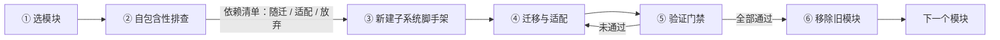

# 存量单体拆解指南

本章面向「大单体前端 → 多子系统」的渐进式拆解场景：已有单体工程（如 sh-demo-ui，RuoYi-Vue3 体系）按业务域逐步拆为多个基于 `@sh/ui-core` 的子系统。接入侧的标准写法见[第二章 ui-core 核心包](./ui-core)与[第四章 接入实践](./practice)，本章只讲拆解本身的方法论——**怎么判断能不能拆、迁移时改什么、改完怎么验、旧模块何时删**。首个落地案例：sh-demo-ui 仓库内 sh-k8s-ui（k8s 运维模块拆解）。

## 拆解总览



两条核心原则贯穿全程：

- **新项目先行，旧代码不动**：先在新子系统中完整复刻并验证可用，再从单体移除；移除与新建分两个独立任务（独立提交），随时可回滚。
- **路径保持，最小适配**：新子系统沿用单体中 `src/api/<域>`、`src/views/<域>` 的目录路径，业务代码除 import 适配外零改动，后端菜单 component 配置天然兼容。

## 第一步：选择拆解模块

候选模块按以下标准打分，全部满足再动手：

| 标准 | 判断方法 |
|---|---|
| 业务域边界清晰 | 模块对应独立的后端服务或接口前缀（如 `/micro-k8s`），功能内聚 |
| 模块外引用少 | 模块目录外的代码极少引用该模块（第二步反向排查确认） |
| 对单体公共层依赖浅 | 引用的 `@/utils`、`@/components` 等在 `@sh/ui-core` 中有等价物，或可随迁 |
| 菜单树独立成组 | 后端菜单中该模块的页面集中在一个或少数几个菜单组下，便于整体挪归属 |
| 无单体强耦合页面 | 不依赖单体首页、全局大屏等跨域页面 |

## 第二步：自包含性排查

排查产出一张依赖清单，把模块的每一处外部依赖归为三类：**随迁**（原样复制即可）、**适配**（改写 import 或配置）、**放弃**（留在单体或用包能力替代）。

### 2.1 正向依赖：模块引了谁

在模块目录内扫描全部 import，按目标分三类处理：

```bash
# 示例：扫描 k8s 模块的 import 来源（rg / 全局搜索均可）
rg "^import .+ from \"([^\"]+)\"" src/views/<mod> src/api/<mod>
```

| import 目标 | 分类 | 处理方式 |
|---|---|---|
| `@/api/<mod>/**`、`@/views/<mod>/**`、`./xxx`、`../xxx` | 随迁 | 新项目保持相同目录路径，导入零改动 |
| `@/utils/request`、`@/utils/auth` 等 | 适配 | 改为 `@sh/ui-core` 深路径（见第四步映射表） |
| `~/env` 的 `baseApi` / `appCode` | 适配 | 新项目 env.js 提供同名字段，保留 `~` 别名即可 |
| `@/components/<组件>` | 适配或放弃 | 优先换用包内组件（如 MonacoEditor）；包内没有再随迁组件目录 |
| `@/store/**`、`@/plugins/**`、`@/directive/**` | 适配 | 逐一核对 `@sh/ui-core` 的 store/插件/指令等价物（见 ui-core.md 能力清单），无等价物则随迁并去耦合 |
| 第三方 npm 包（echarts、monaco-editor、splitpanes 等） | 适配 | 包 dependencies 已含的无需声明；未含的加入新项目 package.json |

另需盘点**模板级依赖**：全局组件（`<pagination>`、`<dict-tag>`、`<table-setting>` 等）与全局方法（`proxy.parseTime`、`proxy.$modal` 等）在代码里没有 import，单看 import 分析会漏。扫一遍模块内模板与 script，对照 ui-core.md「内置全局能力清单」确认全部有包内等价物。

**特殊请求识别**：不走统一 request 实例的调用（SSE `text/event-stream`、WebSocket、裸 fetch/EventSource）要单独核对——token、app-code、baseApi 的取值来源需在新项目中等价成立（如 SSE 从 env.js 直读 `baseApi`/`appCode`、从 `@sh/ui-core/utils/auth` 取 token）。

### 2.2 反向引用：谁引了模块

在模块目录**以外**的全仓库范围搜索模块路径，确认零引用：

```bash
# 示例：确认 k8s 模块没有被 views/api 之外的代码引用
rg -l "<mod>" src --glob '!src/views/<mod>/**' --glob '!src/api/<mod>/**'
```

- 零引用：可以整体搬走。
- 有引用：先解耦再拆——被引用的公共部分（组件、工具）提升到 ui-core 或单体公共层，或在新子系统中复制一份；引用方留在单体。

### 2.3 依赖清单定稿

把上述结果整理成一张表（拆解评审用），示例如 sh-k8s-ui 拆解时的结论：

| 依赖 | 分类 | 去向 |
|---|---|---|
| `src/api/micro/k8s/**`（4 文件） | 随迁 | request/getToken 两类 import 改包内深路径 |
| `src/views/micro/k8s/**`（20 文件） | 随迁 | 仅 1 处 MonacoEditor import 适配 |
| MonacoEditor 组件 | 放弃（不随迁） | 换用 `@sh/ui-core/components/MonacoEditor` |
| pod.js SSE 直连 fetch | 随迁 + 核对 | token/baseApi/appCode 取值来源逐一等价替换 |
| 全局组件 pagination / table-setting | 放弃 | 包内已内置，无需任何处理 |

## 第三步：新建子系统脚手架

按 [ui-core.md 五分钟接入](./ui-core)（env.js / vite.config.js / main.js / 路由 / 菜单五件套）搭建，拆解场景额外注意四点：

**1. 目录与端口约定**：子系统独立建仓库或独立目录，本地 dev 端口错开（Cookie 不区分端口，localhost 跨端口互通）。已占用端口备案：

| 端口 | 工程 |
|---|---|
| 80 | sh-demo-ui（单体） |
| 1024 | iam-admin-ui |
| 5180 / 5181 | portal-demo / app-demo（ui-core 仓库 demo） |
| 5280 | sh-k8s-ui |

新子系统自 5281 起顺延取号，避免并行开发冲突。

**2. `.npmrc` 私服**：`@sh:registry` 指向 npm 私服（参照 ui-core 仓库 `.npmrc`），凭据放用户级 `~/.npmrc` 不入库。

**3. env.js 协议升级**：单体多为旧式 `cas` 协议（登录地址字段叫 `cas`），子系统统一为 `portal` 协议——导出 `appCode` / `env` / `title` / `portal` / `baseApi` / `runtimeEnv`。portal 取值沿用单体现有登录域名即可，baseApi 与环境域名对齐单体现状；若单体 api 文件从 `~/env` 直读字段，新 env.js 必须导出同名同义字段。两种配置写法（显式配置 / 域名推导）的取舍见[接入实践 2.2](./practice#_2-2-运行时环境-env-js)。

**4. appCode 注册**：新子系统取新 appCode（如 `sh-k8s`），需在 iam 侧注册应用；联调期用 `menuSource: 'local'` 本地菜单先跑通，切 `remote` 前完成菜单归属调整（见第六步）。

本地菜单契约与 views 组件池匹配规则见 [ui-core.md 动态路由](./ui-core#动态路由与远端菜单)：一级菜单 `component: 'Layout'`，二级 component 字符串与 `import.meta.glob('../views/**/*.vue')` 组件池键中 `views/` 后的路径一致。

## 第四步：迁移与适配

### 4.1 目录结构原则：路径保持不变

把单体中 `src/api/<mod>/`、`src/views/<mod>/` **原路径原结构**复制进新项目 `src/` 下。收益有三：

- 模块内部 `@/api/...`、`@/views/...`、相对路径导入全部零改动；
- 后端菜单树中该模块的 component 字符串（如 `micro/k8s/ops/pod/index`）在新 appCode 下原样可用，远端菜单接入时后端菜单数据只需挪归属、无需改配置；
- 后续从单体移除时，删除边界就是这两个目录，干净利落。

### 4.2 导入适配映射表

| 单体写法 | ui-core 子系统写法 | 说明 |
|---|---|---|
| `import request from '@/utils/request.js'` | `import request from '@sh/ui-core/utils/request'` | 请求封装等价替换，token / app-code / 401 / 防重复提交由包内处理 |
| `import { getToken } from '@/utils/auth'` | `import { getToken } from '@sh/ui-core/utils/auth'` | Cookie key 与写读语义一致 |
| `import MonacoEditor from '@/components/MonacoEditor/index.vue'` | `import MonacoEditor from '@sh/ui-core/components/MonacoEditor/index.vue.js'` | 包 dist 为编译产物，.vue 组件路径带 `.vue.js` 后缀 |
| `import { baseApi, appCode } from '~/env'` | 不变 | 新项目 env.js 提供同名字段；vite.config.js 保留 `~` → 项目根别名 |
| env.js 导出 `cas`（旧登录协议） | env.js 导出 `portal` + `runtimeEnv` | 协议升级，见第三步第 4 点 |
| `@/api/<mod>/**`、`@/views/<mod>/**`、相对路径 | 不变 | 目录结构保持（4.1） |
| `useDict` / `proxy.$modal` / `proxy.resetForm` / 全局组件 | 不变 | 包内已内置同名同义能力 |
| `@/store/**`、`@/plugins/**` 等包外能力 | 逐项映射 | 对照 ui-core.md 深路径导出参考，无等价物才随迁 |

### 4.3 适配兜底自检

迁移完成后在新项目 `src/` 下做一次残留扫描，**预期零命中**：

```bash
rg "@/(utils|components|store|plugins|directive|layout|assets|settings|permission)" <新项目>/src
```

命中即为漏改的旧单体导入（`@/api/<mod>`、`@/views/<mod>` 属于新项目内部路径，不算命中）。逐一改为 `@sh/ui-core` 对应深路径后再进入验证。

## 第五步：验证门禁

全部通过才算拆解完成，任何一项不过回到第四步修复：

| # | 门禁 | 合格标准 |
|---|---|---|
| 1 | 依赖安装 | `pnpm install` 退出码 0，`@sh/ui-core` 从私服就位（首次安装失败优先查 `.npmrc` 与用户级凭据） |
| 2 | 生产构建 | `pnpm build` 退出码 0 且 `dist/` 产出完整（index.html + 静态资源） |
| 3 | dev 冒烟 | `pnpm dev` 启动后请求首页返回 200，随后停掉 dev server |
| 4 | 菜单可用 | `menuSource: 'local'` 下本地菜单每个页面可打开（菜单 component 与组件池匹配）；切 `remote` 后按 appCode 拉到正确菜单树 |
| 5 | 特殊链路 | SSE / WebSocket / 下载等非统一 request 链路逐一手测（token、baseApi 生效） |
| 6 | 无残留旧导入 | 4.3 的 grep 零命中 |
| 7 | 源项目零污染 | `git status` 中源单体无任何 modified，仅有新项目 untracked 目录（新项目建在单体内时）；全程不执行 commit，由开发者自行检查后提交 |
| 8 | 版本一致性 | `@sh/ui-core`、`vue`、`element-plus` 版本与体系内其他应用对齐 |

## 第六步：移除旧模块

**前置条件**：新子系统已在目标环境（至少 uat）验证可用，用户已确认切换。

按清单执行：

| # | 动作 | 说明 |
|---|---|---|
| 1 | 删除单体中 `src/api/<mod>/`、`src/views/<mod>/` | 删除边界即第二步确认的两个自包含目录 |
| 2 | 反向引用复查 | 全仓库 grep 模块路径，确认删除后无悬空 import |
| 3 | 第三方依赖清理 | 核对模块独占的 npm 包（如 monaco-editor）是否仍被单体其他模块使用，仅无人使用时从单体 package.json 移除 |
| 4 | 后端菜单归属调整 | 从单体 appCode 的菜单树移除该模块菜单，加入新子系统 appCode 的菜单树；component 路径不变，仅挪归属 |
| 5 | 用户切换提示 | 新子系统域名、菜单入口变化通知相关使用方 |

**回滚考量**：移除动作收敛为一次独立提交，异常时 `git revert` 该提交即可整体恢复；新子系统与旧单体在过渡期可并存（不同域名 / appCode），确认稳定后再执行第六步。

## 版本说明

| 版本 | 日期 | 说明 |
|------|------|------|
| 1.0.0 | 2026-10 | 初始版本：基于 sh-k8s-ui 拆解实践整理，基线 `@sh/ui-core` 0.0.14 |
