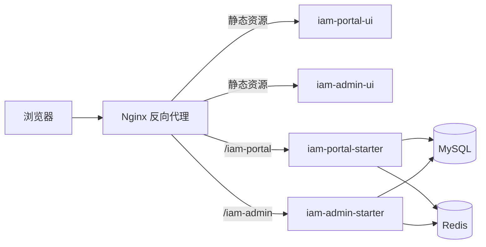

# 部署指南

标准部署形态：Nginx 反向代理统一接入，后端为 iam-portal-starter（认证中心）与 iam-admin-starter（管理中心）两个独立服务，前端产物以静态资源形式部署在 Nginx 子目录下。



依赖服务：MySQL（权限数据）、Redis（会话存储，需高可用）。

## 后端部署

### 构建打包

在仓库根目录执行：

```bash
mvn package -DskipTests
```

产物为两个可执行 jar（spring-boot-maven-plugin 打包）：

- `iam-portal-starter/target/iam-portal-starter-<version>.jar`
- `iam-admin-starter/target/iam-admin-starter-<version>.jar`

### 启动服务

主类：`com.wkclz.iam.portal.starter.IamPortalApplication` / `com.wkclz.iam.admin.starter.IamAdminApplication`。

```bash
java -jar iam-portal-starter-<version>.jar --spring.profiles.active=prod
java -jar iam-admin-starter-<version>.jar --spring.profiles.active=prod
```

默认端口均为 8080，监控端口（Actuator）为 50000。生产环境通过外置配置文件注入环境配置（`--spring.config.additional-location` 或 jar 同级 `config/` 目录）。

### 配置骨架

生产环境 `application-prod.yml` 最小骨架（所有敏感值必须替换为 `<your-xxx>` 占位符对应的真实强密钥）：

```yaml
server:
  port: 8080

spring:
  datasource:
    driver-class-name: com.mysql.cj.jdbc.Driver
    url: jdbc:mysql://<your-mysql-host>:<your-mysql-port>/<your-db-name>?useUnicode=true&characterEncoding=utf8
    username: <your-db-user>
    password: <your-db-password>
  data:
    redis:
      host: <your-redis-host>
      port: <your-redis-port>
      password: <your-redis-password>
      database: <your-redis-db>

iam:
  session:
    token:
      secret-key: "<your-jwt-secret-key>"   # HS256 密钥，≥32 字符；认证中心与各业务应用必须一致
    app-code: "<your-app-code>"             # 独立部署的服务归属应用编码
  login:
    public-key: "<your-rsa-public-key>"     # 密码传输 RSA 公钥（前端加密密码用）
    private-key: "<your-rsa-private-key>"   # 密码传输 RSA 私钥（后端解密密码用）
```

注意事项：

- JWT 密钥变更会导致所有在线会话失效，需谨慎操作
- `iam.login.private-key` 非空时，登录与修改密码接口对超长密码字段执行 RSA 解密，公私钥必须配对
- 各 starter 内置配置仅含骨架（端口、MyBatis、PageHelper、Actuator），profile 默认 `local`，生产必须显式指定

完整配置项与默认值参考：

| 配置域 | 文档 |
| ---- | ---- |
| 会话 / 请求控制（`iam.session.*`、`iam.request-control.*`） | [会话模块](./iam-session) |
| 登录 / 密码策略（`iam.login.*`、`iam.portal.*`） | [门户登录](./iam-portal) |
| 认证中心启动器 | [登录启动器](./iam-portal-starter) |
| 管理中心启动器 | [后台启动器](./iam-admin-starter) |

## 前端部署

iam-portal-ui 与 iam-admin-ui 均以 `npm run build`（或 `npm run build:stage` 构建预发）产出 `dist` 目录。

### 产物形态

- **相对路径产物**：`vite build` 以 `base: './'` 构建（dev 维持 `/`，dev 不支持相对 base），产物可部署在任意子目录
- **hash 路由**：路由以 `/#/` 锚点呈现，文档路径恒定，无需服务端路由回退到多级路径

### Nginx 子目录部署

```nginx
location /portal/ {
    alias /opt/site/<your-portal-ui-dist>/;
    index index.html;
    try_files $uri $uri/ /portal/index.html;
}

location /admin/ {
    alias /opt/site/<your-admin-ui-dist>/;
    index index.html;
    try_files $uri $uri/ /admin/index.html;
}
```

`try_files` 兜底指向该子目录的 `index.html`，配合 hash 路由保证任意深链接可直达。

### 子系统前缀转发镜像模式

子系统在本地联调或网关转发时，将本站前缀（如 `/portal`）代理到门户部署源：

```nginx
location /portal/ {
    proxy_pass http://<your-portal-upstream>/;   # 末尾 / 去除 /portal 前缀
}
```

前端 vite dev server 等价配置：

```js
proxy: {
  '/portal': {
    target: '<your-portal-origin>',
    changeOrigin: true,
    rewrite: (p) => p.replace(/^\/portal/, '')
  }
}
```

**rewrite 必须去前缀**：否则远端 `try_files` 会把 `/portal/static/*` 回退成 `index.html`，造成 HTML 被当作 JS 加载的 MIME 错误。此形态下 `env.js` local 段配置 `portal: '/portal'`，登录页在本站 origin 运行，Token Cookie 落本站同源。

### 父域 Cookie 形态

同父域生产部署（门户部署在专属域名根路径）时，Token Cookie 落父域，业务子系统同父域共享登录态；门户域名根路径与子目录部署均可。

## env.js 环境配置机制

前端工程根目录的 `env.js` 提供无构建改配置的运行时环境机制，导出 `runtimeEnv` 供 `@sh/ui-core` 运行时注入。

### 环境判定

按当前访问 host 判定，未命中则默认 prod：

| host 特征 | 环境 |
| --------- | ---- |
| 含 `127.0.0.1` / `localhost` | local |
| 含 `.dev.` | dev |
| 含 `.sit.` | sit |
| 含 `.uat.` | uat |
| 其他 | prod |

### 地址推导

配置未显式给出且当前为**域名访问**（hostname 含 `.` 且非 IP）时，取当前域名首段替换推导地址：访问 `app.<your-domain>` 时，API 地址推导为 `api.<your-domain>`，门户地址推导为 `portal.<your-domain>`。

`localhost` / IP 访问不推导，需通过 mock 或 dev server proxy 提供地址。

### mock 覆盖

localStorage 配置优先级最高，可覆盖对应地址：

| localStorage key | 覆盖目标 |
| ---------------- | -------- |
| `mock-api` | API 网关基址（`baseApi`） |
| `mock-portal` | 门户登录地址（`portal`，仅 admin-ui） |

### appCode

前端应用的归属编码，用于鉴权资源定位：iam-admin-ui 为 `auth`，iam-portal-ui 为 `portal`。
