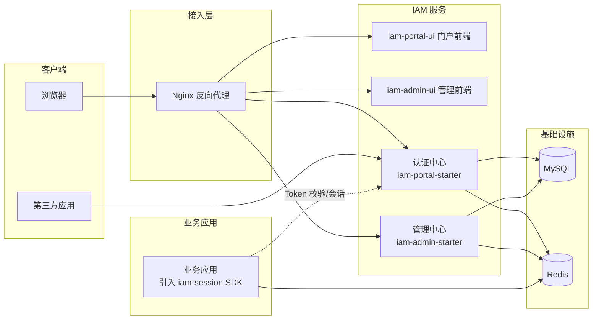
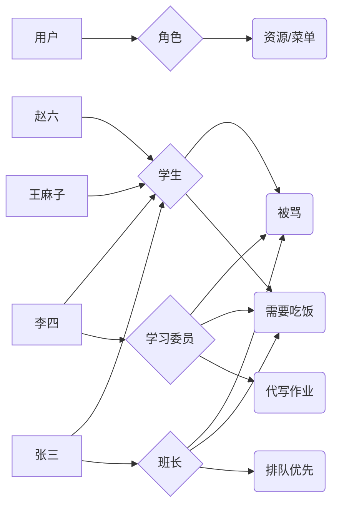

# 权限模块

sh-iam 是身份识别与访问管理系统（IAM，Identity and Access Management），围绕 4A 能力构建：

- 账号（Account）：用户、部门、岗位的组织化账号体系
- 认证（Authentication）：统一登录、会话管理、JWT Token
- 授权（Authorization）：基于 RBAC 的角色/菜单授权，URL 级鉴权
- 审计（Audit）：登录记录、操作记录、请求记录

版本 5.1.x，基于 JDK 25 与 Spring Boot，后端为微服务形态，前端为 Vue 3 + Vite 单页应用。

## 整体架构



- 认证中心（iam-portal-starter）负责统一登录、Token 签发与登出，会话数据存于 Redis
- 管理中心（iam-admin-starter）负责账号、角色、菜单、API 等管理配置
- 业务应用通过 iam-session SDK 在本地完成 Token 校验与 URL 鉴权，与认证中心共享 JWT 密钥与 Redis

## 模块组成

| 模块 | 说明 |
| ---- | ---- |
| iam-common | 公共模块：实体、常量、工具 |
| iam-session | 会话模块：会话管理、JWT Token、认证过滤器、请求控制（SDK） |
| iam-portal | 门户登录：统一登录、注册、个人中心、菜单树 |
| iam-portal-starter | 门户登录独立启动器，部署为认证中心 |
| iam-portal-ui | 门户登录前端界面（package name：`sh-portal-ui`） |
| iam-admin | 管理后台：用户、角色、菜单等管理 |
| iam-admin-starter | 管理后台独立启动器，部署为管理中心 |
| iam-admin-ui | 管理后台前端界面（package name：`sh-admin-ui`） |

后端路由前缀：管理端 `/iam-admin`，门户端 `/iam-portal`。

## 集成方式选择

sh-iam 提供两种集成形态，可并存组合：

### SDK 嵌入

业务应用以依赖方式引入 iam-session，在本应用进程内完成会话校验、URL 鉴权与请求控制。

```xml
<dependency>
    <groupId>com.wkclz.iam</groupId>
    <artifactId>iam-session</artifactId>
</dependency>
```

- 适用：任意需要登录鉴权的业务应用
- 配置：JWT 密钥、白名单、并发会话等，详见 [会话模块](./iam-session)
- Token 由认证中心签发，SDK 仅做校验，业务应用不感知登录流程

### Starter 独立部署

认证中心与管理中心以独立服务部署，集中维护账号、角色、菜单等权限数据。

- 适用：搭建统一认证/授权中心，供多个业务应用接入
- iam-portal-starter：统一登录、注册、个人中心，详见 [登录启动器](./iam-portal-starter)
- iam-admin-starter：权限数据管理，详见 [后台启动器](./iam-admin-starter)

### 组合形态

典型生产形态为「认证/管理中心独立部署 + 业务应用 SDK 嵌入」：用户统一在门户登录获取 Token，各业务应用通过 SDK 校验 Token 并执行自身鉴权策略。

## RBAC 模型

RBAC（Role-Based Access Control，基于角色的访问控制）：权限与角色相关联，用户通过成为角色的成员而得到这些角色的权限。权限赋予角色，角色赋予用户，中间以角色为纽带，简化权限管理。

### 模型图



### 权限描述

- 张三是班长
- 李四是学习委员
- 所有的人都是学生
- 班长排队优先
- 学习委员需要帮代写作业
- 所有的职位都需要吃饭，也都会被骂

以上描述均以角色为中间关系：给定任何一个人，都能知道他的角色；给定任何一个角色，都能知道他涉及的事，从而确认任何一个人涉及的事。示例中的"排队优先、代写作业"等即受控资源，在新库 IAM 体系中以菜单形式配置。

### 实体与 IAM 表对照

| 模型实体 | IAM 模块 | 说明 |
| -------- | -------- | ---- |
| 用户 | 用户管理 | 权限主体，归属部门与岗位 |
| 角色 | 角色管理 | 权限载体，连接用户与资源 |
| 资源 | 菜单管理 | 受控资源，以菜单形式配置权限 |
| — | 部门管理 | 组织架构，用户的归属维度 |
| — | 岗位管理 | 岗位信息，用户的职务维度 |

## 相关文档

- [快速开始](./quick-start)：SDK 集成、服务部署、前端本地开发三条路径
- [部署指南](./deployment)：后端打包启动、前端 Nginx 部署、env.js 环境配置
- 模块文档：[会话模块](./iam-session) / [门户登录](./iam-portal) / [登录启动器](./iam-portal-starter) / [登录界面](./iam-portal-ui) / [管理后台](./iam-admin) / [后台启动器](./iam-admin-starter) / [后台界面](./iam-admin-ui) / [公共模块](./iam-common)
