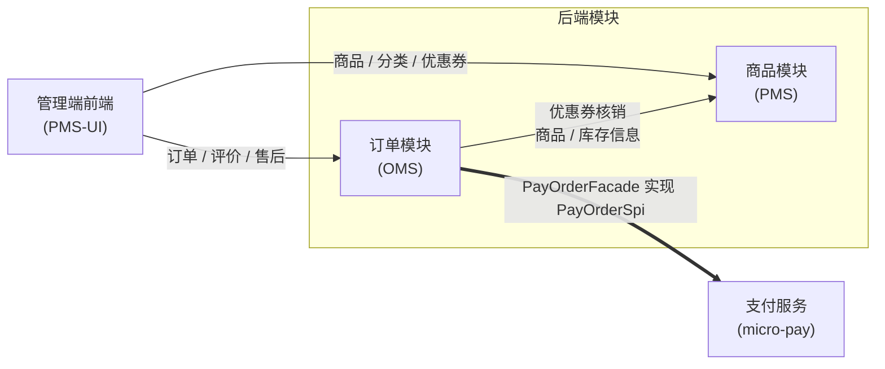

# 商城系统

商城系统是基于 sh-framework 的商城业务工程，由商品（PMS）、订单（OMS）两大后端模块与管理端前端（PMS-UI）构成。后端以 Spring Boot 业务模块 + 启动器组织，可被宿主应用依赖接入；商品模块覆盖商品、分类、属性、SKU、库存与优惠券，订单模块覆盖订单、购物车、拼团、评价与售后，支付能力由独立支付模块提供（参见[支付服务](/micro/micro-pay)）。本文档面向外部合作方与接入开发者，仅包含架构设计、接口规范与接入指引。

## 系统构成

| 模块 | 代码路径 | Maven / 工程标识 | 职责简述 |
|------|----------|------------------|----------|
| 商品模块（PMS） | `sh-pms` | `com.wkclz.pms:sh-pms:5.0.0-SNAPSHOT`（`sh-pms-admin` + `sh-pms-admin-starter`） | 商品、分类、属性、SKU、库存与优惠券管理，面向 C 端输出商品浏览、领券中心与卡包接口（38 个接口） |
| 订单模块（OMS） | `sh-oms` | `com.wkclz.oms:sh-oms:5.0.1-SNAPSHOT`（`sh-oms-admin` + `sh-oms-admin-starter`） | 下单、购物车、拼团、评价与售后，10 个订单状态；经 `PayOrderFacade` SPI 实现支付模块的 `PayOrderSpi` 完成支付解耦（38 个接口） |
| 管理端前端（PMS-UI） | `sh-demo-ui/sh-pms-ui` | `sh-pms-ui`（Vue3 + Vite + @sh/ui-core 体系） | 运营管理端：商品、分类、订单、优惠券、快捷入口等 9 个业务页面，API 层分别对接 PMS 与 OMS |

## 模块依赖与交互

- **下单链路**：PMS-UI / 客户端 → OMS 下单 → `PayOrderFacade` 发起支付 → 支付回调更新订单状态
- **优惠券链路**：PMS 发放优惠券 → OMS 下单核销

## 版本对应关系

| 组件 | 版本 | 说明 |
|------|------|------|
| `sh-pms` | 5.0.0-SNAPSHOT | 商品模块（`com.wkclz.pms`） |
| `sh-oms` | 5.0.1-SNAPSHOT | 订单模块（`com.wkclz.oms`） |
| `sh-pms-ui` | 0.0.0 | 管理端前端，未维护版本号，随主仓库发版 |
| `com.wkclz.framework:sh-parent` | — | 后端两模块共同 parent |

## 文档导航

- [商品模块](./pms) - 架构设计、数据模型、生命周期与接口规范
- [订单模块](./oms) - 订单状态机、支付解耦与接口规范
- [管理端前端](./pms-ui) - 技术栈、目录结构与后端对接
- [支付服务](/micro/micro-pay) - 商城支付能力由独立支付模块提供
