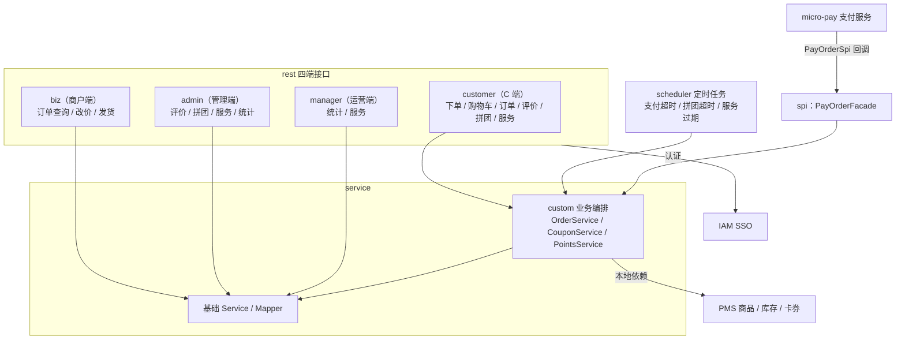
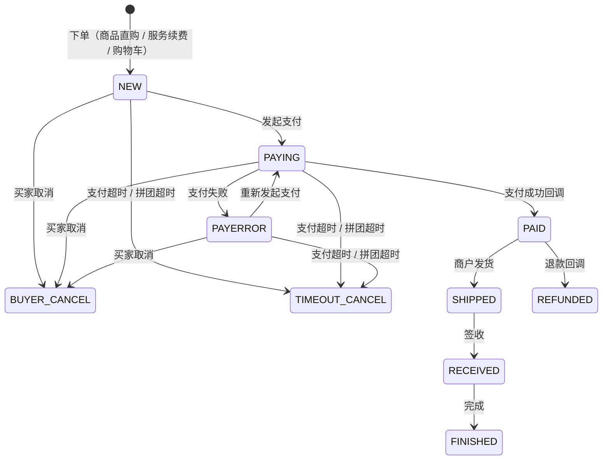

# 订单模块（OMS）

订单模块（OMS，Order Management System）是商城系统的订单中心，负责下单、支付状态同步、订单履约、拼团、购物车、订单评价与售后服务（续费服务）等能力，通过 SPI 与支付服务解耦，通过本地依赖与商品模块（PMS）协作。商品领域概念与规则参见 [商品模块](./pms)。

| 项 | 值 |
|------|------|
| Maven 坐标 | `com.wkclz.oms:sh-oms:5.0.1-SNAPSHOT`（聚合工程） |
| 子模块 | `sh-oms-admin`（业务模块）、`sh-oms-admin-starter`（启动器） |
| 包根 | `com.wkclz.oms` |
| 源码仓库 | `D:\code\sh-oms` |

## 核心架构

模块按「rest 四端 → service → spi / scheduler」分层：

| 分层 | 构成 | 说明 |
|------|------|------|
| `rest` | `customer` / `biz` / `admin` / `manager` 四端 Controller | C 端下单与订单查询、商户端订单管理、管理端评价与拼团、运营端统计 |
| `service` | `*Service` 基础 CRUD + `custom` 业务编排 | `OrderService`（关单编排）、`CouponService`（卡券抵扣）、`PointsService`（积分抵扣） |
| `spi` | `PayOrderFacade` | 实现支付模块 `micro-pay` 的 `PayOrderSpi`，接收支付侧回调 |
| `scheduler` | 3 个定时任务 | 支付超时关单、拼团超时、服务过期 |
| `helper` | `OrderNoHelper` | 订单号生成 |
| `config` | `OmsConfig` | 调度开关配置 |



模块依赖：`iam-sso`（认证）、`sh-pms-admin`（商品/库存/卡券）、`micro-pay`（支付）、`micro-fileos`（文件签名）、`micro-points`。

## 订单生命周期

### 状态定义

订单状态字段 `OmsOrder.orderStatus`（子订单 `OmsOrderItem.orderStatus` 同步维护），状态值由 `ORDER_STATUS` 字典翻译：

| 状态 | 说明 | 触发来源 |
|------|------|------|
| `NEW` | 待支付 | 下单成功（三条下单链路）、商户改价后回归 |
| `PAYING` | 支付中 | 支付发起回调 `updateOrderToPaying` |
| `PAYERROR` | 支付失败 | 支付侧失败处理，可重新发起支付 |
| `PAID` | 已支付 | 支付成功回调 `updateOrderToPaid`，同步子单 |
| `SHIPPED` | 已发货 | 商户端子订单更新接口 |
| `RECEIVED` | 已签收 | 商户端子订单更新接口 |
| `FINISHED` | 已完成 | 商户端子订单更新接口 |
| `BUYER_CANCEL` | 买家取消 | C 端订单取消接口 |
| `TIMEOUT_CANCEL` | 超时取消 | 支付超时 / 拼团超时关单 |
| `REFUNDED` | 已退款 | 退款完成回调 `updateOrderToRefunded` |



要点：
- 只有 `NEW` / `PAYING` / `PAYERROR` 状态的订单可被取消或改价；改价后订单回到 `NEW`，已存在的支付单被逻辑删除。
- `PAID` 之后进入履约阶段，发货 / 签收 / 完成由商户端子订单更新接口推进（订单与子订单状态同步维护）。
- 订单类型 `orderType`：`ORIGIN`（原始订单）、`BALANCE_PRE`（尾款订单，订金单支付前的关联子单，经 `parentOrderNo` 关联）。
- 价格类型 `priceType`：`DEPOSIT`（订金价）、`PRICE`（促销价）、`ORIGIN`（原价）、`BALANCE`（尾款）、`PROMOTION`（服务续费促销价）。

### 三种下单链路

| 链路 | 接口 | 流程要点 |
|------|------|------|
| 商品直购 | `POST /oms/customer/product/ordering`（`ProductOrderingReq`） | 校验 SKU 库存与商品在售状态 → 按传入价格匹配价格类型（订金 / 促销 / 原价）→ 购买限制检测 → 扣减库存 → 卡券抵扣（订金单不可用）→ 积分抵扣 → 生成 `NEW` 订单与订单项；订金单（`DEPOSIT`）自动生成尾款单（`BALANCE_PRE` / `BALANCE`），尾款单继承卡券并在支付时合并订金金额计算满减门槛 |
| 服务续费 | `POST /oms/customer/service/ordering`（`ServiceOrderingReq`） | 按 `serviceNo` 找回服务与 SKU → 以促销价（缺省原价）计价 → 库存校验与扣减 → 卡券、积分抵扣 → 生成 `NEW` 订单，`priceType=PROMOTION` |
| 购物车下单 | `POST /oms/customer/cart/ordering`（`CartOrderingReq`） | 按购物车 `ids` 校验归属 → 逐 SKU 校验并扣减库存 → 合并为一张订单（多商品时子单号追加 `_N` 序号）→ 卡券、积分抵扣 → 清空对应购物车项 |

下单公共规则：
- 金额链路：`totalAmount`（总金额）→ 卡券抵扣得 `paymentAmount` → 积分抵扣得最终实付，实付保底 `0.01` 元。
- 卡券：仅使用用户卡包中的卡券（校验未使用、未过期），支持折扣券 `DISCOUNT` 与抵用券 `VOUCHERS`；使用后卡包标记已使用，关单时退回。
- 积分：`100 积分 = 1 元`，抵扣金额向下取整并封顶（不吞掉实付保底金额）；积分按订单项金额比例拆分到子订单（末项兜底），供支付侧与退款使用。

## 超时与异常处理

三个定时任务均由 `OmsConfig` 开关控制（默认关闭），并通过 Redis 分布式锁（1 分钟）防止多实例并发执行。

| Scheduler | 调度规则 | 开关（`sh.oms.scheduler.*`） | 处理对象 | 超时判定 | 动作与状态影响 |
|------|------|------|------|------|------|
| `OrderTimeoutSchedule` | 每 2 分钟 | `order-timeout=1` | `ORIGIN` 订单，状态 `NEW` / `PAYING` / `PAYERROR` | `create_time` 在 [近 1 个月， 1 天前]，即创建超 1 天未支付 | 置 `TIMEOUT_CANCEL`（取消理由「支付超时」），并级联处理 |
| `OrderGroupTimeoutSchedule` | 每分钟 | `order-group-timeout=1` | 超时拼团 `OmsOrderGroup` | 团超时未达成 | 当前人数 = 目标人数 → `SUCCESS`（转为不活跃）；否则 → `FAILD`，并取消团内所有未支付订单（`TIMEOUT_CANCEL`） |
| `ServiceTimeoutScheduler` | 每分钟 | `service-timeout=1` | 生效中的服务 `OmsService` | `enable_end` 早于当前时间 | `enableFlag=0`、`serviceStatus=EXPIRED`，服务停止使用 |

### 取消与回滚路径

用户取消（`BUYER_CANCEL`）与超时取消（`TIMEOUT_CANCEL`）走同一套关单逻辑 `OrderService.cancelOrder`：

1. 订单状态置为取消类型，同步更新全部子订单状态；订金订单（含 `DEPOSIT` 订单项）自动级联取消其尾款子单。
2. 卡券退回：已使用的用户卡券 `useFlag` 重置为 0，可再次使用。
3. 拼团回滚：拼团当前人数减 1（自动脱团）；团尚在创建态（`CREATING`）时直接关团（`CANCEL`、转为不活跃）。
4. 库存回补：按子订单数量直接回补 SKU 库存（`UPDATE pms_sku_stock SET stock = stock + quantity`），下单时扣减的销量不回滚。

退款不在 OMS 内发起：支付侧完成退款后经 SPI 回调 `updateOrderToRefunded`，订单置为 `REFUNDED`。改价场景下，`PAYING` / `PAYERROR` 订单已有的支付单会被逻辑删除（`pay_order.status=0`）后重新支付。

## 数据模型

| 实体 | 表名 | 说明 |
|------|------|------|
| `OmsOrder` | `oms_order` | 订单主表：订单号 / 父订单号 / 类型 / 金额（总额、优惠、实付、应付）/ 状态 / 收货信息 / 支付流水 / 卡券与积分抵扣 |
| `OmsOrderItem` | `oms_order_item` | 子订单（订单项）：SKU / 数量 / 单价 / 价格类型 / 物流信息 / 积分拆分 |
| `OmsOrderGroup` | `oms_order_group` | 拼团（订单团）：目标人数 / 当前人数 / 团状态（`RUNNING`、`SUCCESS`、`FAILD`、`CANCEL`，创建态 `CREATING` 代码保留） |
| `OmsOrderItemEvaluation` | `oms_order_item_evaluation` | 子订单评价：评分 / 标签 / 晒图 / 正文，`pid` 支持回复树 |
| `OmsCartItem` | `oms_cart_item` | 购物车项：用户 / SKU / 数量 |
| `OmsService` | `oms_service` | 服务（续费对象）：服务行号 / 服务状态（`IN_USE` 使用中、`EXPIRED` 已过期）/ 有效期 |

实体关系：
- 订单 1—N 子订单（`order_no` 关联）；单商品订单的子单号 = 订单号，购物车多商品订单子单号为 `订单号_N`。
- 子订单 1—N 评价（`order_item_no` 关联，`pid` 组织回复层级）；子订单 1—N 服务（`order_item_no` 关联，续费下单时引用 `serviceNo`）。
- 拼团 1—N 订单（`order_group_id` 关联）；订金单与尾款单通过 `parent_order_no` 关联。

### 单号规则

`OrderNoHelper.genOrderNo(businessType)` 基于 Redis 时间戳序列生成器（`TimestampSequenceGenerator`）生成全局递增单号，订单业务类型为 `order`。订单号与子单号共用该规则，保证单号全局唯一、趋势递增。

## 接口规范

所有接口挂在 `/oms` 前缀下（`@Router(module = "oms")`），返回统一结构 `R<T>`，请求 / 响应均封装 Req / Resp 对象，身份信息（用户、租户）由网关上下文（`IdentityContext`）注入。

### customer（C 端，23 个）

| 路径 | 方法 | 说明 |
|------|------|------|
| `/oms/customer/product/ordering` | POST | 商品直购下单 |
| `/oms/customer/service/ordering` | POST | 服务续费下单 |
| `/oms/customer/cart/ordering` | POST | 购物车下单 |
| `/oms/customer/cart/item/list` | GET | 购物车列表 |
| `/oms/customer/cart/item/add` | POST | 加入购物车 |
| `/oms/customer/cart/item/increase` | POST | 购物车数量加一 |
| `/oms/customer/cart/item/reduce` | POST | 购物车数量减一 |
| `/oms/customer/cart/item/quantityset` | POST | 设置购物车数量 |
| `/oms/customer/cart/item/remove` | POST | 移除购物车项 |
| `/oms/customer/order/page` | GET | 订单分页查询 |
| `/oms/customer/order/detail` | GET | 订单详情 |
| `/oms/customer/order/cancel` | POST | 取消订单（仅待支付 / 支付中 / 支付失败） |
| `/oms/customer/order/count` | GET | 用户订单数量统计 |
| `/oms/customer/order/item/list` | GET | 子订单列表 |
| `/oms/customer/order/item/evaluation/new` | POST | 新增评价 |
| `/oms/customer/order/item/evaluation/info` | GET | 评价详情 |
| `/oms/customer/order/product/evaluation/page` | GET | 商品评价分页 |
| `/oms/customer/order/item/evaluation/reply` | POST | 评价回复 |
| `/oms/customer/group/purchase/order/count` | GET | 拼团订单统计 |
| `/oms/customer/group/purchase/order/page` | GET | 拼团订单分页 |
| `/oms/customer/user/group/purchase/order/page` | GET | 用户拼团分页 |
| `/oms/customer/user/group/purchase/order/info` | GET | 用户拼团详情 |
| `/oms/customer/service/page` | GET | 用户服务分页 |

### biz（商户端，5 个）

| 路径 | 方法 | 说明 |
|------|------|------|
| `/oms/order/page` | GET | 订单分页查询 |
| `/oms/order/detail` | GET | 订单详情 |
| `/oms/order/item/list` | GET | 子订单列表 |
| `/oms/order/price/change` | POST | 订单改价（仅未支付订单，改后回到待支付） |
| `/oms/order/item/update` | POST | 子订单更新（物流信息、发货 / 签收 / 完成状态） |

### admin（管理端，8 个）

| 路径 | 方法 | 说明 |
|------|------|------|
| `/oms/admin/order/item/evaluation/page` | GET | 评价分页 |
| `/oms/admin/order/item/evaluation/new` | POST | 新增评价 |
| `/oms/admin/order/item/evaluation/remove` | POST | 删除评价 |
| `/oms/admin/order/item/evaluation/reply` | POST | 评价回复 |
| `/oms/admin/order/group/page` | GET | 拼团分页 |
| `/oms/admin/order/group/item/list` | GET | 拼团订单项列表 |
| `/oms/admin/dashboard/order/week/count` | GET | 订单周统计 |
| `/oms/admin/service/info` | GET | 服务信息 |

### manager（运营端，2 个）

| 路径 | 方法 | 说明 |
|------|------|------|
| `/oms/manager/dashboard/order/week/count` | GET | 订单周统计 |
| `/oms/manager/service/page` | GET | 服务分页 |

## 外部接入方案

### 依赖引入

```xml
<dependency>
    <groupId>com.wkclz.oms</groupId>
    <artifactId>sh-oms-admin</artifactId>
    <version>5.0.1-SNAPSHOT</version>
</dependency>
```

- `sh-oms-admin` 为业务模块，通过 Spring Boot 自动装配引入（`OmsAutoConfig`：扫描 `com.wkclz.oms` 包与 `com.wkclz.oms.mapper`），宿主应用需同时引入其依赖的 `iam-sso`、`sh-pms-admin`、`micro-pay` 等模块。
- `sh-oms-admin-starter` 为独立启动器，可将 OMS 作为独立服务部署（默认端口 8080）。

### 配置项

| 配置键 | 默认值 | 说明 |
|------|------|------|
| `sh.oms.scheduler.order-timeout` | `0` | 支付超时关单调度开关，`1` 开启 |
| `sh.oms.scheduler.order-group-timeout` | `0` | 拼团超时调度开关，`1` 开启 |
| `sh.oms.scheduler.service-timeout` | `0` | 服务过期调度开关，`1` 开启 |

### 支付对接（SPI）

OMS 与支付通过 `micro-pay` 定义的 SPI 接口 `PayOrderSpi` 解耦：OMS 提供 `PayOrderFacade` 实现，支付服务在关键节点回调 OMS 完成订单状态同步。接入方无需自行实现该 SPI，只需部署支付服务（见 [支付服务](/micro/micro-pay)）并保证两模块可互调。

`PayOrderFacade` 方法清单：

| 方法 | 调用时机 | 前置状态 | 状态影响 |
|------|------|------|------|
| `getOrderInfoForPay(orderNo)` | 支付发起前获取订单支付信息（金额、积分等；支持传子单号回查父订单） | — | 只读 |
| `updateOrderToPaying(orderNo)` | 发起支付 | `NEW` | 订单 → `PAYING` |
| `updateOrderToPaid(payResult)` | 支付成功回调 | `PAYING` / `PAYERROR` | 订单 → `PAID`（写入支付方式、支付流水号、支付时间），子单 `NEW` / `PAYING` → `PAID` |
| `updateOrderToRefunded(orderNo)` | 退款完成回调 | — | 订单 → `REFUNDED` |
| `updateOrderToTimeout(orderNo)` | 支付超时处理 | — | 走统一关单逻辑 → `TIMEOUT_CANCEL`（回补库存、退回卡券） |

## 与其他模块的关系

| 关联 | 方向 | 方式 | 说明 |
|------|------|------|------|
| PMS 商品 / 库存 | OMS → PMS | 本地依赖（`sh-pms-admin`） | 下单时读取商品与 SKU、校验并扣减库存、购买限制检测；关单时直接回补库存 |
| PMS 卡券 | OMS → PMS | 本地依赖（`sh-pms-admin`） | `CouponService` 读取卡券与用户卡包、核销与退回 |
| 积分 | OMS → 积分 | 本地计算 | `PointsService` 负责抵扣金额计算与订单项拆分（100 积分 = 1 元），积分账户操作随支付流程处理 |
| 支付 | OMS ← 支付 | SPI 回调（`PayOrderSpi`） | 支付发起 / 成功 / 失败 / 退款 / 超时回调驱动订单状态流转，见 [支付服务](/micro/micro-pay) |
| IAM | OMS → IAM | 本地依赖（`iam-sso`） | 用户身份、租户隔离 |
