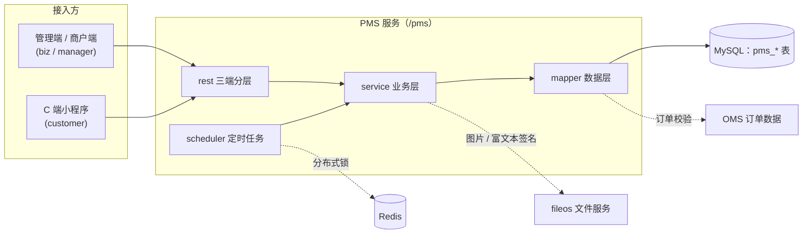

# 商品模块（PMS）

商品模块（PMS，Product Management System）是商城系统的商品域服务，提供商品、分类、属性、SKU、库存与优惠券的管理能力，并面向 C 端小程序输出商品浏览、领券中心与卡包接口。本文面向外部合作方与接入开发人员，描述模块的架构设计、功能边界、数据模型、生命周期与接口规范。

- Maven 坐标：`com.wkclz.pms:sh-pms-admin`（业务模块）、`com.wkclz.pms:sh-pms-admin-starter`（启动模块），版本 `5.0.0-SNAPSHOT`
- 源码工程：`sh-pms`，包根 `com.wkclz.pms`
- 路径前缀：所有接口统一挂在 `/pms` 前缀下（`Route.PREFIX`）

## 核心架构

工程由两个 Maven 模块构成：

| 模块 | 说明 |
|------|------|
| `sh-pms-admin` | 业务模块，包含实体、Rest 接口、Service、Mapper 与定时任务，作为依赖被宿主应用引入 |
| `sh-pms-admin-starter` | 启动模块，提供可运行的 Spring Boot 启动器（`IamAdminApplication`），自身不承载业务 |

包分层（`com.wkclz.pms`）：

| 包 | 职责 |
|----|------|
| `rest/biz` | 商户 / 平台管理端接口：商品、分类、平台卡券、商户卡券 |
| `rest/manager` | 平台运营接口：卡券发放与兑换码管理 |
| `rest/customer` | C 端小程序接口：商品浏览、分类树、领券中心、卡包 |
| `service` | 业务层，承载商品、SKU、卡券等领域逻辑 |
| `mapper` | MyBatis 数据层，含跨模块查询 OMS 订单数据的 `OmsMapper` |
| `scheduler` | 定时任务：卡券过期、卡券定时发放、商品销量汇总 |
| `config` / `helper` | 模块配置（`PmsConfig`）、分类树构建（`TreeHelper`） |



管理端接口经 iam-portal 会话鉴权；图片与富文本内容由 fileos 签名后返回。

## 功能边界

**本模块负责**：

- 商品（SPU）与 SKU 的创建、维护、上下架
- 商品分类的层级维护
- 商品属性与属性值维护，属性值组合生成 SKU
- SKU 库存、价格、限购管理
- 优惠券的定义、发放、领取、兑换与过期处理

**本模块不负责**：

- 订单、交易履约：由 OMS 订单模块承担
- 支付与退款：见[支付服务](/micro/micro-pay)
- 秒杀、拼购等营销活动的交易能力：为规划中能力，本模块不含其对外接口

## 数据模型

### 实体清单

| 实体 | 表名 | 说明 |
|------|------|------|
| PmsProduct | `pms_product` | 商品（SPU）：商品编码、分类编码、类型（PRODUCT/SERVICE）、名称与副标题、上下架 / 新品 / 推荐 / 审核状态、图文详情、销量汇总 |
| PmsProductCategory | `pms_product_category` | 商品分类：父编码（pcode）构成父子层级、图标、横幅、关键词、可见性 |
| PmsProp | `pms_prop` | SKU 属性：从属于商品（productCode），属性编码、属性名、展示名 |
| PmsPropItem | `pms_prop_item` | SKU 属性枚举值：从属于属性（propCode），值编码、值名称 |
| PmsSkuStock | `pms_sku_stock` | SKU 库存信息：skuCode、原价 / 现价、库存 / 锁定库存 / 预警库存、属性组合（properties）、限购、销量 |
| PmsCoupon | `pms_coupon` | 卡券：发放范围（PLATFORM 平台 / MERCHANT 商户）、类型、面值 / 折扣、使用门槛与范围、总量 / 剩余量、状态、生效起止时间 |
| PmsUserCoupon | `pms_user_coupon` | 用户卡包：用户编码与卡券编码关联、兑换码、有效期、使用标记（useFlag）、过期标记（expireFlag） |

卡券状态（couponStatus）由运营操作与定时任务驱动，如 `ISSUED`（发放中）、`EXPIRED`（已过期）、`SOLDOUT`（已下架）。

### 核心概念

| 概念 | 英文 | 定义 |
|------|------|------|
| 商品 | SPU（Standard Product Unit） | 标准产品单位，商品信息聚合的最小单位，是一组可复用、易检索的标准化信息集合，描述一个产品的特性 |
| 库存量单位 | SKU（Stock Keeping Unit） | 库存进出计量的单位，可以件、盒、托盘等为单位。如纺织品的 SKU 通常表示：规格、颜色、款式 |
| 分类 | Category | 商品的类别区分，方便用户查找。分类有层级关系，可无限分子类 |
| 属性 | Property | 商品的特性，决定商品的细节差异，用于区分 SKU |
| 属性值 | Property Value | 商品属性的具体内容，属性值的组合构成商品的不同 SKU |

要点：系统需存在默认的商品分类；参数（Parameter）概念暂不引入，避免模型过度复杂。

### SKU 生成规则

| 规则 | 说明 |
|------|------|
| 规格组数 | 最少一组，最多三组，每组规格下可定义多个规格值 |
| 生成方式 | 规格值组合自动生成 SKU，SKU 编码自动产生 |
| 修改限制 | SKU 一经生成，不允许修改规格个数与规格值个数，仅可修改描述类信息 |
| 调整方式 | 需变更 SKU 个数时，废弃商品后重建 |

属性支持两种维护级别：**系统级**（维护默认属性与属性值，不绑定具体商品，所有商品可选用）与**商品级**（创建商品后临时添加，仅绑定当前商品）。当前实体通过 `productCode` 关联商品。

### 实体关系

| 实体 | 关系 | 备注 |
|------|------|------|
| 商品（SPU） | 1..n SKU | SKU 通过 `productCode` 从属商品 |
| 分类 | 父子层级 | 通过 `pcode` 构成树，`TreeHelper` 负责建树 |
| 属性 | 从属于商品 | 通过 `productCode` 关联 |
| 属性值 | 从属于属性 | 通过 `propCode` 关联 |
| SKU | 由属性值组合生成 | 属性组合存于 `properties` 字段 |

## 商品生命周期

### 状态定义

| 状态 | 说明 | 对应字段 |
|------|------|----------|
| 新建 | 商品创建后的初始状态，未上架 | `publishStatus = 0` 且未发布 |
| 已上架 | 商品对外可见，C 端可搜索、可交易 | `publishStatus = 1` |
| 已下架 | 不提供 C 端搜索，仅管理端可搜索 | `publishStatus = 0` |

### 可执行操作矩阵

| 操作 | 新建 | 已上架 | 已下架 |
|------|------|--------|--------|
| 编辑基础信息 | ✓ | ✗ | ✗ |
| 编辑库存、价格、描述类信息 | ✓ | ✓ | ✓ |
| 删除 | ✓ | 未被 C 端引用时可删除 | — |
| 上架 | ✓ | — | — |
| 下架 | — | ✓ | — |

**实现要点**：

- 上架校验：商品必须已维护启用状态（`enableFlag = 1`）的 SKU，否则拒绝上架
- 下架校验：通过 `OmsMapper` 查询 OMS 订单数据，存在进行中的拼团订单时禁止下架，需待订单全部完成或超时
- 已上架只能下架，不能回到新建状态
- 已上架商品一旦被 C 端引用（收藏、加购物车、购买等），仅提供下架操作，不再提供删除
- `POST /pms/product/changeStatus` 用于切换新品状态（newStatus）与推荐状态（recommandStatus），不改变上下架状态

## 接口规范

接口统一前缀 `/pms`，响应包裹与错误码遵循平台统一约定。管理端接口需登录会话，C 端接口需用户 token。

### 管理端（biz / manager，共 29 个）

**商品**（ProductRest，9 个）：

| 接口路径 | 方法 | 说明 |
|----------|------|------|
| `/pms/product/page` | GET | 商品分页查询 |
| `/pms/product/info` | GET | 商品详情查询（含图文详情签名） |
| `/pms/product/sku/info` | GET | 商品 SKU 列表查询 |
| `/pms/product/save` | POST | 商品保存（新增 / 修改） |
| `/pms/product/sku/save` | POST | 商品 SKU 保存 |
| `/pms/product/remove` | POST | 商品删除 |
| `/pms/product/shelves/on` | POST | 商品上架 |
| `/pms/product/shelves/off` | POST | 商品下架 |
| `/pms/product/changeStatus` | POST | 商品新品 / 推荐状态切换 |

**商品分类**（ProductCategoryRest，5 个）：

| 接口路径 | 方法 | 说明 |
|----------|------|------|
| `/pms/product/category/list` | GET | 商品分类列表 |
| `/pms/product/category/info` | GET | 商品分类详情 |
| `/pms/product/category/save` | POST | 商品分类保存 |
| `/pms/product/category/remove` | POST | 商品分类删除 |
| `/pms/product/category/options` | GET | 商品分类下拉选项（树形） |

**平台卡券**（PlatformCouponRest，6 个）：

| 接口路径 | 方法 | 说明 |
|----------|------|------|
| `/pms/platform/coupon/page` | GET | 平台卡券分页查询 |
| `/pms/platform/coupon/info` | GET | 平台卡券详情 |
| `/pms/platform/coupon/save` | POST | 平台卡券保存 |
| `/pms/platform/coupon/remove` | POST | 平台卡券删除 |
| `/pms/platform/coupon/status/on` | POST | 平台卡券启用 |
| `/pms/platform/coupon/status/off` | POST | 平台卡券停用 |

**商户卡券**（MerchantCouponRest，6 个）：

| 接口路径 | 方法 | 说明 |
|----------|------|------|
| `/pms/merchant/coupon/page` | GET | 商户卡券分页查询（按租户隔离） |
| `/pms/merchant/coupon/info` | GET | 商户卡券详情 |
| `/pms/merchant/coupon/save` | POST | 商户卡券保存 |
| `/pms/merchant/coupon/remove` | POST | 商户卡券删除 |
| `/pms/merchant/coupon/status/on` | POST | 商户卡券启用 |
| `/pms/merchant/coupon/status/off` | POST | 商户卡券停用 |

**卡券发放（平台运营，ManagerCouponRest，3 个）**：

| 接口路径 | 方法 | 说明 |
|----------|------|------|
| `/pms/manager/coupon/issue/all` | POST | 卡券发放给所有用户（排除已持有者，扣减剩余量） |
| `/pms/manager/coupon/issue/new/user` | POST | 卡券发放给新用户（未下单用户） |
| `/pms/manager/coupon/exchange_code/list` | GET | 卡券兑换码生成与列表查询（仅限隐藏的线下卡券） |

### 客户端（customer，共 9 个）

**商品浏览**：

| 接口路径 | 方法 | 说明 |
|----------|------|------|
| `/pms/miniapp/product/page` | GET | 商品分页查询（仅已上架商品） |
| `/pms/miniapp/product/info` | GET | 商品详情查询（含 SKU 与图文详情签名） |
| `/pms/miniapp/product/topnew/list` | GET | 最新商品列表（默认 12 条） |
| `/pms/miniapp/product/category/options/tree` | GET | 商品分类树 |

**领券与卡包**：

| 接口路径 | 方法 | 说明 |
|----------|------|------|
| `/pms/customer/coupon/all_coupons/page` | GET | 领券中心分页查询（仅发放中且展示的卡券，含个人领取状态） |
| `/pms/customer/coupon/receive` | POST | 卡券领取（校验状态、时间与剩余量，写入个人卡包并扣减库存） |
| `/pms/customer/user/coupon/page` | GET | 个人卡包分页查询 |
| `/pms/customer/coupon/exchange_code/info` | GET | 兑换码查询（校验兑换码有效性与卡券状态） |
| `/pms/customer/coupon/exchange` | POST | 卡券兑换（兑换码绑定当前用户，幂等防重复使用） |

## 外部接入方案

### 依赖引入

在宿主应用中引入业务模块：

```xml
<dependency>
    <groupId>com.wkclz.pms</groupId>
    <artifactId>sh-pms-admin</artifactId>
    <version>5.0.0-SNAPSHOT</version>
</dependency>
```

说明：

- 版本号由父 POM 的 `revision` 属性统一管理，当前为 `5.0.0-SNAPSHOT`
- 传递依赖 `com.wkclz.iam:iam-portal`（会话与租户上下文）、`com.wkclz.microapp:micro-fileos`（图片与富文本签名 URL）
- 模块通过 `PmsAutoConfig` 自动装配：`@ComponentScan("com.wkclz.pms")` 扫描业务组件，`@MapperScan("com.wkclz.pms.mapper")` 注册数据层，宿主应用无需额外配置
- `sh-pms-admin-starter` 为独立启动模块（`IamAdminApplication`），仅用于将 PMS 作为独立服务运行，接入方无需引入

### 配置项

| 配置项 | 类型 | 默认值 | 说明 |
|--------|------|--------|------|
| `shrimp.pms.scheduler.coupon-expired` | Integer | 0 | 卡券过期定时任务开关，`1` 开启 |
| `shrimp.pms.scheduler.coupon-issued` | Integer | 0 | 卡券定时发放任务开关，`1` 开启 |
| `shrimp.pms.scheduler.product-sale-count` | Integer | 0 | 商品销量汇总任务开关，`1` 开启（当前调度注解未启用，为预留能力） |
| `mybatis.mapper-locations` | String | `classpath*:mapper/**/*.xml` | 模块自带 Mapper XML 的装载路径 |
| `mybatis.configuration.map-underscore-to-camel-case` | Boolean | true | 下划线转驼峰映射 |
| `pagehelper.helperDialect` | String | mysql | PageHelper 分页插件方言 |
| `spring.datasource.driver-class-name` | String | `com.mysql.cj.jdbc.Driver` | 数据源为 MySQL |

### 定时任务

| 任务 | 职责 |
|------|------|
| CouponExpiredScheduler | 定期将到达失效时间的卡券置为 `EXPIRED`，并同步过期用户卡包记录 |
| CouponIssuedScheduler | 定期将到达发放时间的卡券置为 `ISSUED`，进入可领取状态 |
| ProductSaleCountScheduler | 汇总 SKU 销量回写商品的销量汇总字段（预留，调度未启用） |

任务均通过 Redis 分布式锁保证多实例下单节点执行，受上表配置开关控制。

## 与其他模块的关系

- **OMS（订单）**：PMS 通过 `OmsMapper` 跨模块查询 OMS 订单数据（`oms_order_group`、`oms_order_item`）。当前用于商品下架校验——商品存在近 2 天内进行中的拼团订单时禁止下架；另预留拼团 / 抢购销量统计查询。优惠券的发放、领取、兑换与过期在 PMS 完成，订单侧的用券与核销由 OMS 处理
- **支付**：订单与支付流程见[支付服务](/micro/micro-pay)
- **IAM**：管理端接口依赖 iam-portal 提供会话鉴权与租户上下文（tenantCode），商户数据按租户隔离
- **fileos**：商品图片、卡券 Logo 与富文本详情通过 fileos 签名后返回
