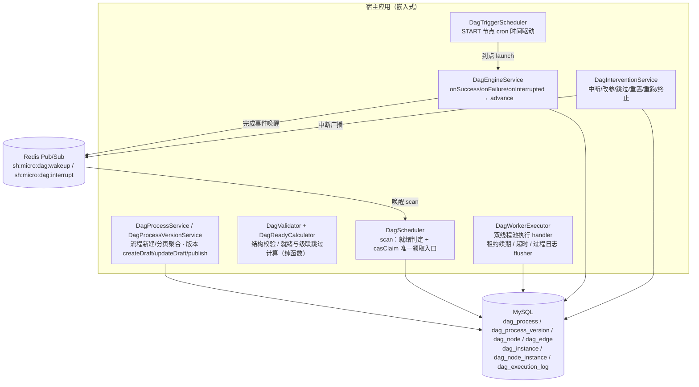
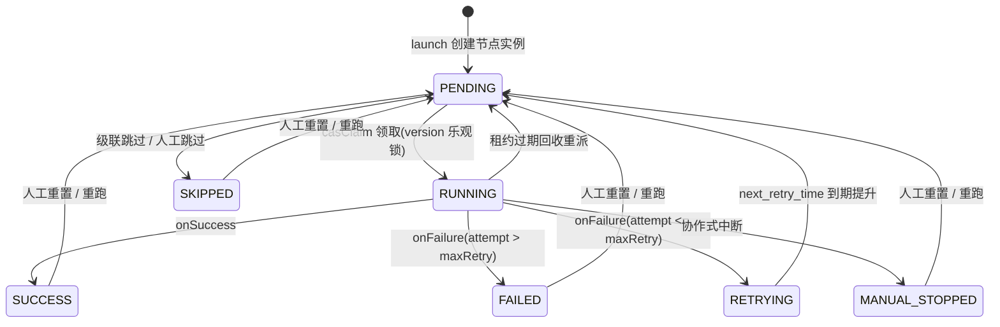
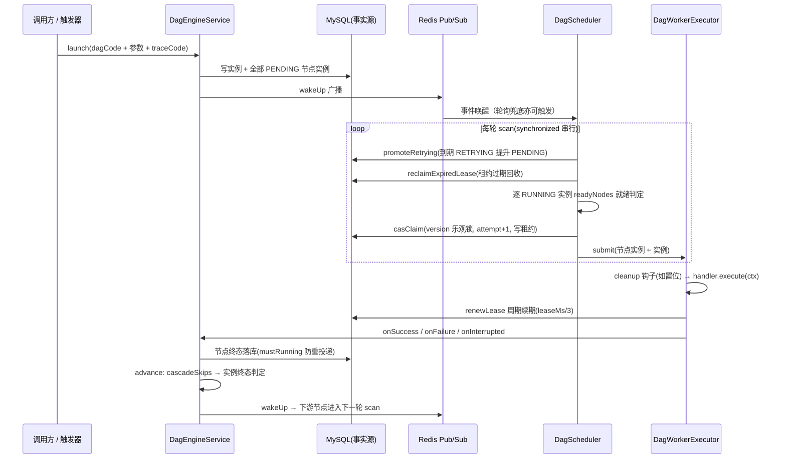

# 设计思路

micro-dag 是嵌入式轻量分布式 DAG 编排引擎，核心设计理念：**定义静态化、调度对等化、状态推进幂等化**。流程版本（节点 + 边 + 参数）静态存储并版本化发布，实例发起时快照为节点实例集合；调度不依赖中心节点，多宿主实例对等竞争领取任务；全部状态迁移汇合于数据库 CAS 更新，天然幂等，事件与轮询只是两种"触发时机"，不是两套状态逻辑。

## 整体架构

引擎随宿主应用启动（`DagAutoConfig` 自动装配，无独立 server），由流程与版本服务、调度、执行、推进引擎、人工干预五个运行组件与两个调度旁路（时间驱动触发器、过程日志 flusher）构成。MySQL 是唯一事实源，Redis Pub/Sub 仅作加速通道（唤醒与中断广播）。



各组件职责：

| 组件 | 职责 |
|------|------|
| DagProcessService | 流程域：新建流程（主表插行 + 创建 v0 草稿）、流程分页（按 dagCode 聚合版本状态 EDITING/PUBLISHED 与 draftId/latestVersion/latestPublishedId） |
| DagProcessVersionService | 版本域：load（运行时装配共用入口）、createDraft/updateDraft/publish/detail/versionList |
| DagScheduler | 调度循环（`@Scheduled` 轮询兜底 + `wakeUp()` 事件唤醒），单轮执行 promoteRetrying → 租约回收 → 逐 RUNNING 实例就绪计算 → batchSize 限流 CAS 领取 → 提交 worker。`scan()` 方法 `synchronized` 串行，CAS 领取是任务执行的唯一入口，防重复执行 |
| DagWorkerExecutor | 节点执行器，双线程池设计：`dag-worker` 池跑 handler，`dag-supervisor` 监督线程只做等待与结果派发（租约续期在独立的单线程 `dag-lease` 池），避免"等待者占满工作线程"饿死。负责租约续期、超时控制、中断协作、traceCode 回填、结果五路派发 |
| DagEngineService | 推进引擎，节点成功/失败/中断回调落库（`mustRunning` 防重投递）→ 级联跳过 → 实例终态判定 → Redis 唤醒调度 |
| DagReadyCalculator | 就绪计算、级联跳过计算、实例终态计算的纯函数集合，无状态，调度与推进两侧共用同一套判定逻辑 |
| DagExpressionEvaluator | 自研分支表达式引擎，递归下降文法，无第三方依赖 |
| DagRetryCalculator | 重试间隔计算：FIXED 固定，EXPONENTIAL 第 n 次 = intervalSec × 2^(n-1)（封顶 2^20 防溢出） |
| DagValidator | 定义校验器，返回问题清单（面向设计器展示）不抛异常；发布时由版本服务转为校验失败 |
| DagInterventionService | 人工干预治理：interrupt / params / skip / reset / rerun / rerun-from / terminate |
| DagTriggerScheduler | START 节点时间驱动触发器，轮询 PUBLISHED 流程版本，cron 到点自动 launch |
| DagRedisPublisher / DagWakeupListener / DagInterruptListener | Redis 广播收发：完成事件唤醒调度、跨机中断请求（payload = `instanceCode:nodeCode`） |

## 数据模型

七张 `dag_` 前缀表，均继承 BaseEntity（`version` 乐观锁、`deleted` 逻辑删除、`create_by`/`update_by` 自动填充）：

| 实体 | 表名 | 关键字段 |
|------|------|----------|
| DagProcess | dag_process | dagCode（唯一）、dagName（名称唯一持有于主表，历史版本显示当前名称） |
| DagProcessVersion | dag_process_version | dagCode + dagVersion（草稿固定 0，发布重挂为历史最大版本+1）、status（DRAFT/PUBLISHED） |
| DagNode | dag_node | dagCode + dagVersion、nodeCode、nodeType（NORMAL/START/END/BRANCH）、handler、timeoutMs、maxRetry、intervalSec、backoff、paramsJson、posX/posY（画布坐标） |
| DagEdge | dag_edge | dagCode + dagVersion、edgeCode、fromCode → toCode、type（NORMAL/CONDITION）、whenExpr（条件表达式） |
| DagInstance | dag_instance | instanceCode（模块内生成）、traceCode（唯一跟踪编码，可运行期回填）、dagCode + dagVersion（发起时锁定版本）、status（RUNNING/SUCCESS/FAILED/STOPPED/TERMINATED）、contextJson（流程上下文）、bizParamsJson（发起参数） |
| DagNodeInstance | dag_node_instance | instanceCode + nodeCode、status（七态）、attempt、handler / maxRetry / intervalSec / backoff / timeoutMs（定义快照，可改参覆盖）、inputParamsJson（人工改参写入处）、outputJson、leaseOwner、leaseExpireTime（故障转移依据）、interruptFlag、cleanupFlag、errorMsg、nextRetryTime、skipReason、stopReason |
| DagExecutionLog | dag_execution_log | instanceCode + nodeCode + attempt、event（执行事件枚举）、detailJson（异常栈摘要/参数快照）、logText（NODE_LOG 过程日志专用字段）、worker（执行机器标识） |

要点：

- **流程与版本两级**：同一 dagCode 的名称唯一持有于 dag_process 主表；dag_process_version 按版本组织节点与边，唯一索引 uk_code_version 保证同一流程至多一个编辑中草稿（并发创建由 DuplicateKeyException 拦截）；实例发起时锁定 PUBLISHED 最大版本，运行期不受后续发布影响。
- **节点实例是定义快照**：重试策略、超时等执行属性发起时从定义拷入节点实例，人工改参（`/node/params`）直接修改节点实例的 inputParamsJson，重跑时生效。
- **traceCode 唯一**：launch 时应用层查重校验（重复即拒绝），保证定时触发等场景以 traceCode 为幂等键；节点执行结果也可携带 traceCode 回填实例（仅当实例 traceCode 为空时生效）。
- **执行记录是节点审计流**：每次状态迁移、干预操作、过程日志均写一条执行记录（attempt 维度），实例详情时间线由此渲染。

## 节点状态机

节点实例七态（`NodeStatus`），终态四态：SUCCESS / FAILED / SKIPPED / MANUAL_STOPPED；SKIPPED 与 SUCCESS 同视为"满足下游依赖"（`satisfiesDownstream()`）。



关键迁移与触发事件：

| 迁移 | 触发方 | 执行记录事件 |
|------|--------|--------------|
| PENDING → RUNNING | DagScheduler.casClaim（version 乐观锁 + status 前置校验双保险，attempt+1） | CLAIM |
| RUNNING → SUCCESS | DagEngineService.onSuccess | SUCCESS |
| RUNNING → RETRYING | onFailure 且 attempt ≤ maxRetry，写 nextRetryTime | RETRY_SCHEDULED |
| RUNNING → FAILED | onFailure 且 attempt 耗尽 | FAIL / TIMEOUT |
| RUNNING → MANUAL_STOPPED | 协作式中断命中（中断标记 + cancel） | INTERRUPT |
| RUNNING → PENDING | 租约过期回收（lease_expire_time < now），重派 | LEASE_RECLAIM |
| RETRYING → PENDING | 调度提升（next_retry_time ≤ now） | — |
| PENDING → SKIPPED | 级联跳过（skipReason=上游分支条件不满足）或人工跳过 | SKIP |

实例状态（`InstanceStatus` 五态）由全部节点状态推导：全部节点到达终态时，任一 FAILED / MANUAL_STOPPED 则实例 FAILED，否则 SUCCESS；TERMINATED 由人工终止接口设置。

## 调度时序

一次完整的"发起 → 执行 → 推进下游"过程如下（轮询兜底通道与事件唤醒通道最终汇入同一个 `scan()`）：



## 核心机制详解

### 双通道状态推进

状态推进有两条触发通道，但只有一套落库逻辑：

- **事件通道**：节点完成回调（onSuccess/onFailure/onInterrupted）在事务内落库后，直接执行 `advance()` 计算级联跳过与实例终态，再经 Redis 广播唤醒调度器领取下游——跨实例场景下由持锁实例各自响应。
- **轮询通道**：`DagScheduler.tick()` 按 `dag.scheduler.interval-ms`（默认 5000ms）兜底扫描，覆盖事件丢失、进程重启等场景。

两通道汇合于数据库 CAS：`casClaim` 要求 `status='PENDING' AND version=#{version}` 双保险，回调落库要求 `mustRunning`（非 RUNNING 的重复回调直接忽略）。事件重复投递、双通道并发扫描都不会产生重复执行或状态错乱，天然幂等。`dag.channel` 可降级：`db`=仅轮询（不注册 Redis 监听），`pubsub`=仅事件（不推荐，无兜底），`auto`=双通道（默认）。

### 租约与故障转移

每个 RUNNING 节点实例持有租约（leaseOwner + leaseExpireTime）：

- **租约时长**：无超时节点用 `dag.lease.fixed-ms`（默认 120s）；有超时节点取 `max(fixedMs, timeoutMs + 30s)`，保证租约恒覆盖超时窗口——超时由 worker 侧 `Future.get` 强制，避免超时瞬间与故障转移重派撞车。
- **续期**：监督线程按 `leaseMs / 3` 周期调用 `renewLease`（带 leaseOwner 条件更新），长任务持续保活。
- **故障转移**：持有节点执行的实例宕机后租约到期，调度扫描发现 `RUNNING AND lease_expire_time < now` 即重置 PENDING 并记 LEASE_RECLAIM 事件，下一轮由任意实例重新领取。工作线程无法被强杀，宕机实例重启后由租约自然对齐，无孤儿任务。

### 失败重试

失败回调（FAIL/TIMEOUT/异常）统一进入 `onFailure`：attempt ≤ maxRetry 时置 RETRYING 并计算 nextRetryTime（FIXED 固定间隔；EXPONENTIAL 按 `intervalSec × 2^(attempt-1)` 指数退避，封顶 2^20），到期由 `promoteRetrying` 批量提升回 PENDING 重新走领取流程；attempt 耗尽则置 FAILED。重试语义对超时、异常、显式失败一视同仁，失败消息与输出（如有）随事件落执行记录。

### 分支与级联跳过

- **就绪判定**：节点 PENDING 且全部入边的上游满足下游依赖（SUCCESS 或 SKIPPED），且来自 SUCCESS 上游的 CONDITION 边求值为 true（SKIPPED 上游的条件边视为不满足）。
- **表达式引擎**：语法为 `${ctx.key}` / `${out.<nodeCode>.key}` 占位符 + `== != > >= < <=` + `and or` + 括号 + 字符串/数字/true/false/null 字面量。数值优先比较（两边均可转数字按数值，否则按字典序），单值表达式按真值求值。设计器提供 `/expression/preview` 预览接口。
- **级联跳过**：节点全部入边均"确定性不满足"时置 SKIPPED 并向下游传播。确定性不满足包括三类：上游 FAILED / MANUAL_STOPPED、上游链式 SKIPPED、条件边求值 false。上游处于 PENDING / RUNNING / RETRYING 属**未定状态**，不参与跳过判定——避免把"还没执行"误判为"不会执行"。起始节点永不跳过。
- **分支明细**：BRANCH 节点经 system-branch 执行时对全部出边求值并输出 `{branches: {toCode: bool}, selected: [...]}` 明细；launch 时出边条件已快照进节点入参（branches 最后合并，实例参数不可覆盖分支系统键），实例详情可直接展示。

### 节点分类与系统 handler

`NodeCategory` 三分类决定 handler 生效方式：

| 分类 | 生效方式 |
|------|----------|
| SYSTEM | `handler/system` 包内置 4 个系统 handler（system-start / system-end / system-branch / system-timer），无条件注册，永久生效 |
| DEMO | `handler/demo` 包内置 5 个演示 handler，`dag.demo-enabled=true` 时才注册（默认关闭）；GraalJS 为 optional 依赖，classpath 缺失时 demo-script-exec 自动跳过注册 |
| BUSINESS | 业务方实现的 handler 默认分类，注册即生效 |

设计约束：`NodeHandlerRegistry` 收集容器内全部 handler 并按 nodeCode 索引，重复编码启动即失败；`SystemHandler` 枚举限定系统 handler 与 nodeType 的搭配（system-timer 仅限 NORMAL 节点），由 DagValidator 校验。START/END/BRANCH 统一走 worker 执行链路；**存量兼容**：特殊节点且 handler 为空时（历史版本），调度器领取后直达成功（passthrough），由引擎级联推进下游。

### 重跑清理钩子

重跑（rerun / rerun-from / reset 后再执行）意味着同一 traceCode 下节点将被二次执行，可能产生重复副作用。机制：人工重跑目标节点 attempt > 0 时置 `cleanup_flag=1`，执行器在调用 `handler.execute` 之前先调用 `NodeHandler.cleanup(ctx)` 清理历史数据，并记 CLEANUP 事件、复位标记。handler 按需实现（默认空实现），长任务应在 execute 内周期调用 `ctx.checkInterrupted()` 支持协作式中断。

### 显式失败语义

handler 通过返回值显式区分成功与失败，而非依赖异常：

```java
return NodeResult.ok(Map.of("rows", 100)).withTraceCode("TRC-xxx"); // 成功，output 写 output_json
return NodeResult.fail(Map.of("msg", "上游数据为空"));               // 显式失败，派发 FAIL 事件
```

- `fail(output)` 的 output 仍写入 output_json（RETRYING / FAILED 状态均保留），便于失败排查；
- output 含 String 类型的 `msg` 键时作为失败消息展示，否则使用缺省文案；
- 未捕获异常由监督线程捕获，取栈摘要（1000 字符）派发 FAIL；超时派发 TIMEOUT；中断标记命中派发 INTERRUPT。

### 过程日志上报

handler 内调用 `ctx.log(message)` 上报过程日志，采用"内存缓冲 + 异步落库"设计，避免日志写库拖慢执行线程：

- **缓冲**：NodeContext 内线程安全 StringBuilder 缓冲，累计字符超 `dag.log.max-chars`（默认 8000）后丢弃后续内容并置 truncated 标志；
- **落库**：DagWorkerExecutor 内置单线程 flusher（`dag-log-flusher`，与租约续期线程池隔离，DB 慢不拖累续期）按 `dag.log.flush-interval-ms`（默认 3000ms）扫描本机运行中任务的缓冲，`drainLog()` 原子取走后写 NODE_LOG 事件记录（内容存 logText 独立字段）；
- **兜底**：节点到达终态的 finally 块兜底 drain 一次，曾截断时补 `...[truncated]` 标记，保证截断可感知；周期与兜底并发 drain 不重不漏。

### 时间驱动触发

START 节点 params 配置 `triggerType=TIMER` + `cron`（Spring 6 CronExpression 域）后，`DagTriggerScheduler` 按 `dag.trigger.interval-ms`（默认 30s）轮询 PUBLISHED 流程版本到点自动 launch：

- **幂等**：traceCode = `TIMER-{dagCode}-v{version}-{触发时间 yyyyMMddHHmmss}`，同一触发点仅发起一个实例（launch 的 traceCode 唯一校验天然拦截重复）；
- **防竞争**：Redis 锁 `dag:trigger:lock:{dagCode}:{fireTime}`（tryLock 15s）防集群多实例同时触发；RedisLock 缺失时本轮跳过不崩；
- **触发状态内存态**：dagCode → 版本 + cron + 下次触发时间，版本变化自动重建，重启自动恢复；停机期间错过的历史槽位不补触发，仅补触发最近一个到期槽位（从当前时间重新起算）；
- **负缓存**：无 TIMER 触发的定义按 dagVersion 负缓存，仅版本变更时重新加载，避免每轮全量扫描；
- **开关**：`dag.enabled=false` 或 `dag.trigger.enabled=false` 时触发器不运行，手动 launch 不受影响；triggerType=TIMER 时 cron 必填且可解析（DagValidator 校验）。

### 参数 schema 与定义校验

节点参数采用"handler 声明、设计器渲染、后端校验"的 schema 驱动模式：

- **声明**：`NodeHandler.paramSchema()` 返回 `NodeParamDef` 列表（key/label/type/required/requiredWhen/范围/默认值/SELECT 选项/placeholder/help），控件类型覆盖 TEXT/NUMBER/BOOLEAN/SELECT/DATETIME/CRON/KEY_VALUE/JSON；随 `/handler/list` 下发给设计器，按定义渲染参数表单（表单/JSON 双模式）。
- **校验**：DagValidator 在保存与发布时按 schema 校验 params——必填、条件必填（requiredWhen）、NUMBER 范围、CRON 可解析、DATETIME 格式、SELECT 枚举、KEY_VALUE 结构；schema 未声明的自由键不拦截。免 handler 的存量 START 节点按 nodeType 兜底校验 cron。
- **结构校验**：节点编码唯一与格式、handler 注册、边端点存在、条件边 whenExpr 非空、Kahn 拓扑排序环检测、特殊节点拓扑约束（START 无入边、END 无出边、BRANCH 出边全为条件边）、nodeType 与 handler 匹配；发布时额外校验起始节点存在性。校验结果为问题清单供设计器展示，发布时存在任一问题即失败。

**发布语义**：仅 DRAFT 版本可发布；发布时版本号取该 dagCode 历史最大版本 +1，节点/边行先删除后按新版本重挂，状态置 PUBLISHED；全量校验失败（含起始节点缺失）则发布中断不落任何变更。实例始终以"发起时锁定的版本"运行，编辑历史版本不影响存量实例；已发布版本不可编辑，变更通过"以最新已发布版本为底稿创建新草稿"演进。
