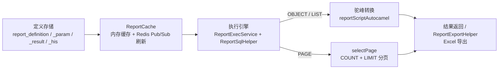
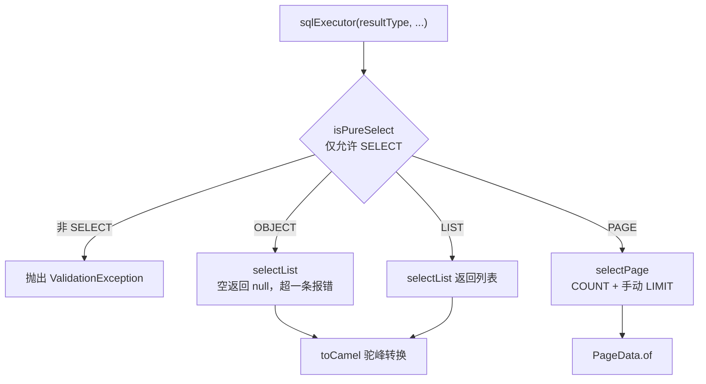

# 设计思路

micro-report 是低代码报表微服务模块，核心设计理念：**报表 = 报表编码 + SQL 数据脚本 + 元数据配置**。管理端维护报表定义（SQL 脚本、入参、结果字段），执行端按元数据动态渲染查询表单、校验参数并执行脚本，实现报表的免发版新增与调整。

## 整体架构

模块由四层构成：定义存储（四张 report_ 前缀表）→ 缓存（ReportCache 内存缓存 + Redis Pub/Sub 广播刷新）→ 执行引擎（ReportExecService 参数校验 + ReportSqlHelper SQL 执行）→ 结果处理与导出（驼峰转换、PAGE 分页包装、ReportExportHelper Excel 导出）。SQL 脚本以 MyBatis 动态 MappedStatement 方式执行，仅允许 SELECT 语句。

## 数据模型

四实体均继承 BaseEntity，统一使用 `report_` 表前缀：

| 实体 | 表名 | 职责 |
|------|------|------|
| ReportDefinition | report_definition | 报表定义主表：reportCode（唯一）、reportName、resultType（OBJECT/LIST/PAGE）、enableFlag、reportScript（SQL 查询脚本）、reportScriptCountSwitch（Count 脚本开关）、reportScriptCount（自定义 COUNT 脚本）、reportScriptAutocamel（自动驼峰转换） |
| ReportDefinitionParam | report_definition_param | 入参配置：fieldCode、fieldName、fieldType（string/number/date/datetime）、fieldFormType（表单类型）、placeholder、required、validateScript（校验 JS 脚本）、dictType、width |
| ReportDefinitionResult | report_definition_result | 结果字段配置：fieldCode、fieldName、fieldType、fieldFormType（展示类型）、width（列宽） |
| ReportDefinitionHis | report_definition_his | 报表定义历史版本，字段与主表一致，dataId 关联主表 id |

关联关系：

- param / result 通过 `reportCode` 与主表关联；报表编码变更时级联更新两张表（`updateReportCodeBatch`），报表删除时级联删除。
- his 通过 `dataId` 关联主表 id，仅记录主表字段快照。

## 数据脚本执行

报表脚本为标准 SQL 查询语句，支持 MyBatis 动态标签（`<if>`/`<where>`/`<foreach>`/`<choose>`/`<trim>` 等，含 CDATA 包裹与 XML 实体转义写法），参数以 `#{paramName}` 占位符绑定，由 MyBatis 预编译执行。

- **参数提取与绑定**：`sql2Params` 通过正则提取脚本中的 `#{paramName}`（支持 `#{item.field}` 取根名）与 `collection="xxx"` 参数，用于参数自动提取；执行时参数以 Map 传入 SqlSession，按参数名绑定。
- **参数校验**（ReportExecService.checkParams）：必填校验（required=1）、number 类型数字校验、validateScript JS 脚本校验（javax.script JS 引擎，返回 false 抛出校验异常）。

三种返回形态在 `ReportSqlHelper.sqlExecutor` 中分流：

- **OBJECT**：执行 selectList 后要求结果恰好一条，空结果返回 null，多条抛出「OBJECT类型查询结果超过一条」异常。
- **LIST**：直接返回 `List<LinkedHashMap<String, Object>>`。
- **PAGE**：手动拼接 `LIMIT offset, size` 分页（PageHelper 对动态注册的 MappedStatement 不生效）；COUNT 优先使用自定义脚本（reportScriptCountSwitch=1 时取 reportScriptCount），否则自动生成 `SELECT COUNT(*)`（去除 ORDER BY），返回 `PageData`。

## SQL 处理与安全

ReportSqlHelper 是 SQL 执行引擎，职责：

- **安全检查（isPureSelect）**：先经 `cleanMyBatisTags` 清理动态标签，再用 Druid `SQLUtils.parseStatements` 解析，全部语句均为 SELECT 才放行，否则执行时抛出「仅允许SELECT查询语句」。
- **动态标签清理（cleanMyBatisTags）**：处理 CDATA 包裹与 XML 实体转义（`&lt;`/`&gt;`/`&amp;`/`&apos;`/`&quot;`），移除 `<if>`/`<where>`/`<set>`/`<foreach>`/`<choose>`/`<when>`/`<otherwise>`/`<trim>` 标签（保留内容），`#{...}` 替换为占位值 `'1'` 供解析使用。
- **动态注册执行（registerSql）**：以 SQL 的 MD5 作为 namespace 构建临时 XML mapper，将脚本注册为 MyBatis MappedStatement（`report_dynamic_{md5}.select`，结果类型 LinkedHashMap），已注册则复用，避免重复注册；通过 SqlSession 执行。
- **结果列提取（sql2Results）**：使用 JSqlParser 解析 SELECT 项的别名或列名（跳过 `SELECT *`），用于结果字段自动提取。
- **驼峰转换**：reportScriptAutocamel=1 时，将结果 key 从下划线转为驼峰。

## 缓存与历史版本

**ReportCache** 缓存策略：

- 启动时（@PostConstruct）加载所有启用的报表定义（`definitions4Cache`）到内存，以 reportCode 为 key 存入 ConcurrentHashMap；缓存为空时懒加载。
- 实现 Redis MessageListener，订阅频道 `sh:micro:report:cache:refresh`；`clearCache()` 发送广播并本地刷新，多实例节点收到消息后各自重载，3 秒防抖。
- 报表定义的新增、修改、删除（definitionCreate/definitionUpdate/definitionRemove）后均触发 `clearCache()`。

**ReportDefinitionHis** 生成时机：报表定义新增（definitionCreate）与修改（definitionUpdate）成功后，通过 `writeHistory` 将主表字段快照（dataId=主表 id）写入历史表；删除不产生历史记录。历史版本可通过 `/definition/his/page` 与 `/definition/his/detail` 查询。

## 导出机制

ReportExportHelper 基于 EasyExcel 实现 Excel（.xlsx）导出，由 `/exec/export` 接口调用：

- **表头来源**：结果字段配置按 sort 顺序生成 `fieldCode → fieldName` 的 LinkedHashMap（getExportHeaders），表头展示 fieldName。
- **数据行**：报表数据（OBJECT 类型取第一条，LIST/PAGE 取全部列表）按 fieldCode 顺序取值，null 转空字符串。
- **写出方式**：直接写入 HttpServletResponse 输出流，Content-Type 为 xlsx MIME，文件名经 URLEncoder 编码；注册 `LongestMatchColumnWidthStyleStrategy` 实现自适应列宽。
