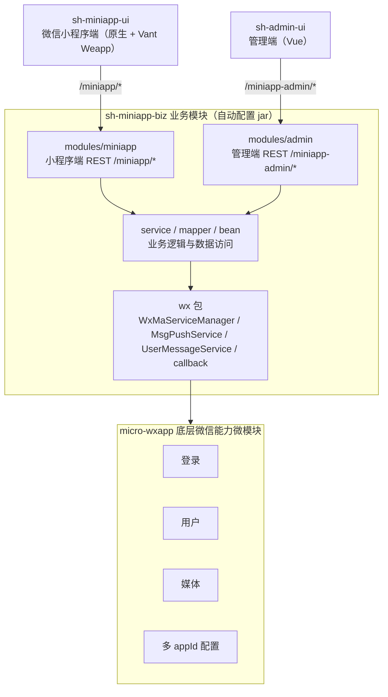
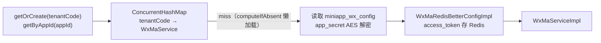
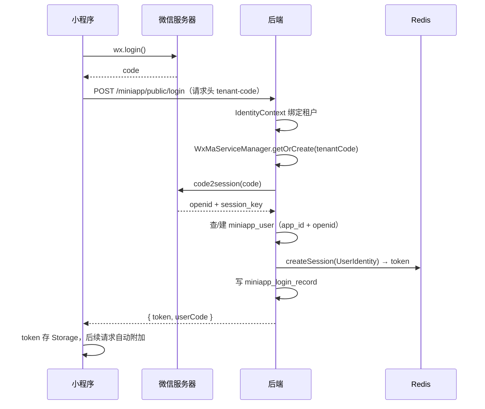

# 设计思路

sh-miniapp 采用「底层能力微模块 + 业务模块 + 双前端」的分层结构：micro-wxapp 提供微信登录、用户、媒体与多 appId 配置等底层能力，sh-miniapp-biz 在其上构建内容、消息、用户三个业务域，并以 Spring Boot 自动配置模块对外暴露；sh-miniapp-ui（小程序端）与 sh-admin-ui（管理端）分别消费 `/miniapp/*` 与 `/miniapp-admin/*` 两套 REST 接口。

## 三端整体架构

- **micro-wxapp**：底层微模块，分层为 rest / service / mapper / bean / config（`WxMaConfiguration`），提供微信登录（`WxappLoginService`）、微信用户与手机号（`WxMaUserRest`）、媒体（`WxMaMediaRest`）、多 appId 配置管理（`WxappConfigService`）能力
- **sh-miniapp-biz**：业务核心 jar，被 `sh-miniapp-starter`（含启动类与 application.yml）聚合启动，也可被任意含启动类的项目依赖获得完整业务能力，依赖方向严格单向
- **双前端**：小程序端 4 个 TabBar 页 + 11 个子页面分包，管理端为 Vue 页面；两端共用同一套后端数据

## 模块划分

sh-miniapp-biz 包路径为 `com.wkclz.miniapp`，各包职责：

| 包 | 职责 |
|------|------|
| `ShMiniappBizAutoConfig` | 自动配置入口（`@AutoConfiguration` + `@ComponentScan` + `@MapperScan`），经 `AutoConfiguration.imports` 注册，依赖方零扫描接入 |
| `bean.entity` | 17 张 `miniapp_*` 表实体，与表一一对应 |
| `config` | `WxConfigProperties`（app_secret 解密密钥）、`IamSessionConfig`（iam-session 白名单等）、`MiniappConstants` |
| `mapper` | MyBatis Mapper 接口，每个实体一个 |
| `modules.admin` | 管理端 REST（`/miniapp-admin/*`）14 个接口类 + req/resp，路由常量 `AdminRoute` |
| `modules.miniapp` | 小程序端 REST（`/miniapp/*`）14 个接口类 + req/resp，路由常量 `MiniappRoute` |
| `service` | 19 个领域 Service（用户、内容、消息、配置等），业务逻辑层 |
| `spi` | `UserInfoExtSpi` 扩展点：依赖方实现并以 `@Component` 注册，即可向 `/miniapp/user/overview` 追加自定义键值对 |
| `wx` | 微信对接：`WxMaServiceManager` 多实例管理、`callback`（客服回调 REST）、`message`（`MsgPushService` 双渠道推送、`UserMessageService` 用户消息落库） |

## 核心数据模型

17 张 `miniapp_*` 表按业务域归类，均含 `tenant_code` 隔离字段与 sort / version / deleted 等公共字段：

| 域 | 表 | 说明 |
|------|------|------|
| 用户域 | `miniapp_user` | 小程序用户，唯一键 `user_code` 与 `(app_id, openid)` |
| | `miniapp_user_setting` | 用户设置（通知 / 深色 / 字体等） |
| | `miniapp_login_record` | 登录记录（成功与失败均落库） |
| | `miniapp_browse_log` | 浏览记录 |
| 内容域 | `miniapp_banner` | Banner 轮播（图片 + 富文本正文 + 跳转链接） |
| | `miniapp_notice` | 通知公告 |
| | `miniapp_quick_entry` | 快捷入口（4 列图标网格） |
| | `miniapp_category` | 分类（两级，`parent_code` 自关联，categoryCode 唯一） |
| | `miniapp_feed` | 内容流（封面 + 摘要 + 富文本正文） |
| | `miniapp_hot_search` | 热门搜索词（管理端配置下发） |
| 消息域 | `miniapp_message` | 站内消息主表 |
| | `miniapp_message_user` | 消息-用户投递关联（已读状态） |
| | `miniapp_user_message` | 用户消息（客服回调 + 小程序反馈，含回复字段） |
| | `miniapp_msg_template` | 推送模板（channel：wechat / inner / both，占位符渲染） |
| | `miniapp_msg_push_log` | 推送记录（双渠道各一条，含 fail_reason） |
| 其他 | `miniapp_favorite` | 收藏 |
| | `miniapp_wx_config` | 微信配置（`tenant_code` 唯一，多租户配置源） |

## 多租户隔离

- **配置源**：`miniapp_wx_config` 以 `tenant_code` 为唯一键，存储 `app_id`、`app_secret`（AES 加密）、回调 `token` / `encoding_aes_key`，是后端的多小程序配置源；管理端支持跨租户 CRUD，变更后失效 `WxMaService` 缓存，删除后不可重建同租户
- **数据隔离**：请求头 `tenant-code` → `IdentityContext` 上下文，所有业务表含 `tenant_code` 字段，查询统一按租户注入条件
- **用户体系**：`miniapp_user` 以 `(app_id, openid)` 为联合唯一键，同一微信用户在不同小程序下为不同记录；`user_code` 全局唯一，作为小程序内用户标识，不做跨租户强关联

## WxJava 多实例机制

`WxMaServiceManager`（`wx` 包）按租户管理 `WxMaService` 实例：

- **本地缓存**：`ConcurrentHashMap<tenantCode, WxMaService>`，`computeIfAbsent` 懒加载，未命中时从 `miniapp_wx_config` 加载配置构建实例
- **集群安全**：access_token 经 `WxMaRedisBetterConfigImpl` 存 Redis（key 前缀 `wx:ma:token:{tenantCode}`），多节点共享，避免重复请求微信刷新 token
- **回调路由**：微信回调 URL 以 `{appId}` 为路径段，`getByAppId(appId)` 按 appId 反查租户后路由到对应实例
- **缓存失效**：`evict(tenantCode)` 在管理端变更配置后调用，下次调用时重建实例
- **密钥安全**：`app_secret` 在库中 AES 加密存储，构建实例时经 `WxConfigProperties` 提供的密钥解密注入

## 微信登录鉴权流程

- **UserIdentity**：以 `user_code` 为标识，attributes 携带 `openid` / `tenantCode` / `appId`，会话由 iam-session（JWT + Redis）管理，无状态可水平扩展
- **Token 管理**：过期时前端拦截 401 → 静默重新登录 → 重放原请求（仅重试 1 次防递归）；登录接口带 12 秒并发登录锁，避免并发重复 code2session
- **手机号绑定**：`<button open-type="getPhoneNumber">` 获取授权码 → `POST /miniapp/user/bind-mobile` → WxJava `getPhoneNoInfo(code)` 换取手机号 → 脱敏存入 `miniapp_user.mobile`
